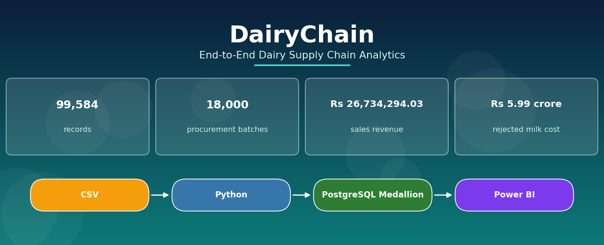

# DairyChain - Dairy Supply Chain Analytics


> Rejected milk cost Rs 5.99 crore out of Rs 48.19 crore of milk purchased. Low SNF alone cost Rs 3.44 crore, more than half of all rejected milk cost.

## For recruiters - the 30-second view

- 99,584 records across 10 CSV files in [data/raw](data/raw).
- PostgreSQL Medallion layers: Bronze 10 tables, Silver 10 tables, Gold 6 tables. See the [Database](#database) screenshots.
- 4 Power BI pages with 63 visuals and 21 DAX measures. See [Dashboards](#dashboards).
- Rejected milk cost Rs 5.99 crore out of Rs 48.19 crore purchased, with Low SNF at Rs 3.44 crore.
- A Colab notebook with 148 code cells in [scripts/dairychain.ipynb](scripts/dairychain.ipynb).

## What this shows

| Skill | Proof in this repo |
|---|---|
| Python and Pandas | [scripts/dairychain.ipynb](scripts/dairychain.ipynb) |
| SQL and PostgreSQL | The database screenshots and the 26 tables in [Database](#database) |
| DAX and Power BI | The 4 dashboard pages in [Dashboards](#dashboards) |
| Data engineering | The Medallion layers and the CSV pipeline in [Medallion Architecture](#medallion-architecture) |
| Business analysis | The 20 business questions with answers in [docs/05_Business_Questions_and_Answers/](docs/05_Business_Questions_and_Answers/) |

## Numbers at a glance

| What | Number |
|---|---|
| CSV files | 10 |
| Total records | 99,584 |
| Procurement batches | 18,000 |
| Batch rejection | 12.84 percent |
| Volume rejection | 12.76 percent |
| Sales revenue | Rs 26,734,294.03 |
| Orders | 14,000 |
| Production batches | 4,000 |
| Gold tables | 6, with 22,596 rows |

## How to run it

1. Clone the repo: `git clone https://github.com/Sonu-mj/dairychain.git`
2. Load the CSV files from `data/raw/` into PostgreSQL.
3. Open `scripts/dairychain.ipynb` to run the Python validation and analysis.
4. Open `docs/13_Project_Evidence/dairy_chain_project.pbix` in Power BI Desktop to see the 4 report pages.

## Project structure

```
dairychain/
├── data/
│   └── raw/            10 CSV files, 99,584 records
├── docs/               full documentation, 93 files
│   ├── assets/         architecture whiteboard, hero banner, digital diagram
│   └── 13_Project_Evidence/  screenshots, PBIX file, dataset files
├── scripts/            dairychain.ipynb, the Colab notebook
├── sql/                notes on the Gold table SQL
├── tests/              notes on testing
├── README.md
└── LICENSE
```

## Purpose
This file is the entry point for DairyChain. It is for a first-time reader who wants to understand the project end to end, in story order, without jumping around. Each section below links to the exact file that covers it, with one line saying what the reader will learn there.

## In this file
- Numbers at a glance
- How to run it
- Project structure
- Business Problem
- Requirements
- For recruiters - the 30-second view
- What this shows
- Dashboards
- Database
- Medallion Architecture
- System Design
- Data Engineering
- Python and SQL
- Business Analytics
- Questions and Actual Answers
- Business Findings
- Management Recommendations
- AI-assisted development, Testing, Debugging, Security, Performance, Engineering Decisions
- Evidence and Glossary

## Numbers used in this file
All numbers below come from the user-supplied README, 2026-11-11, and the supplied CSV files (Source 28), recounted and checksum-shown on 2026-11-11.
- Source: 10 CSV files, 99,584 total records, now in `data/raw/`: suppliers 200, collection_centres 20, products 12, milk_procurement 18,000, quality_tests 18,000, production_batches 4,000, production_inputs 9,352, production_outputs 8,000, sales_orders 14,000, sales_order_lines 28,000. The manifest, data dictionary, validation report (29 checks), and checksums are in `data/`, and the original ZIP is in `docs/13_Project_Evidence/DairyChain_dataset_full.zip`.

## The data is synthetic

This is the material fact a reader must know first. The data is synthetic, not real operational dairy data. It was made for this project, covering 2025-11-01 to 2026-10-31. Names, prices, rates, yields, and volumes are generated values, and the yield factors are illustrative synthetic assumptions, not engineering specifications. The findings in this project describe the generated data; the methods (Medallion layers, validation, DAX measures, rejection analysis) are the real work. Do not present any number here as a real dairy factory's operating result.
- Bronze: ingested source data in PostgreSQL. Silver: 10 cleaned tables. Gold: 6 tables.
- Gold tables: procurement_quality_summary 18,000; collection_centre_performance 20; supplier_performance 200; production_performance 4,000; sales_product_performance 12; sales_daily_summary 364. Row counts from Source 19 (live database COUNT(*), user-supplied screenshot 2026-11-11, total 22,596).
- Procurement: 18,000 batches, 15,689 accepted, 2,311 rejected, batch rejection 12.84 percent, total milk 8,758,507.64 L, rejected milk 1,117,247.35 L, volume rejection 12.76 percent.
- Production: 4,000 batches. Finished litre-based 1,484,135.25 L, byproduct litre-based 466,514.75 L, finished kg-based 266,416.65 kg, byproduct kg-based 402,413.85 kg. Litre and kg must stay separate.
- Intended period: 1 Nov 2025 to 31 Oct 2026, Asia/Kolkata, INR.

## Dashboards

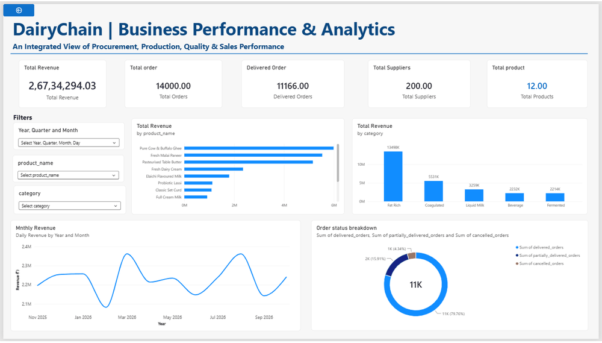

Four Power BI report pages, screenshots taken in Power BI Desktop on 2026-11-11. Pages 1 to 3 show full-period values. Page 4 was captured with a date filter active (01-04-2026 to 06-10-2026), so its cards are filtered values, not full-period totals. Full-period sales are Rs 26,734,294.03 across 14,000 orders.

### Page 1 - Executive Overview

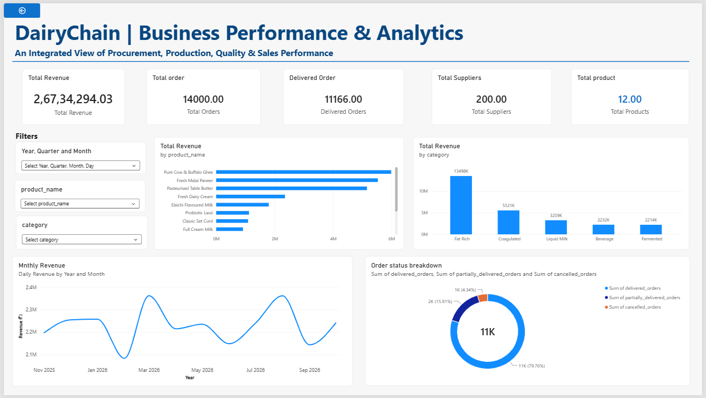

Total Revenue Rs 26,734,294.03, Total Orders 14,000, Delivered Orders 11,166, Total Suppliers 200, Total Products 12.

### Page 2 - Procurement and Quality Analysis

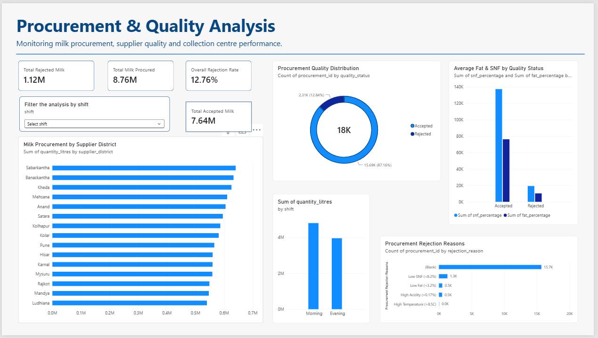

Total Milk Procured 8.76M L, Total Rejected Milk 1.12M L, Overall Rejection Rate 12.76 percent by volume, Total Accepted Milk 7.64M L. The donut on the same page shows the batch rejection rate, 12.84 percent. The two rates are different measures and are kept separate.

### Page 3 - Production Performance Analysis

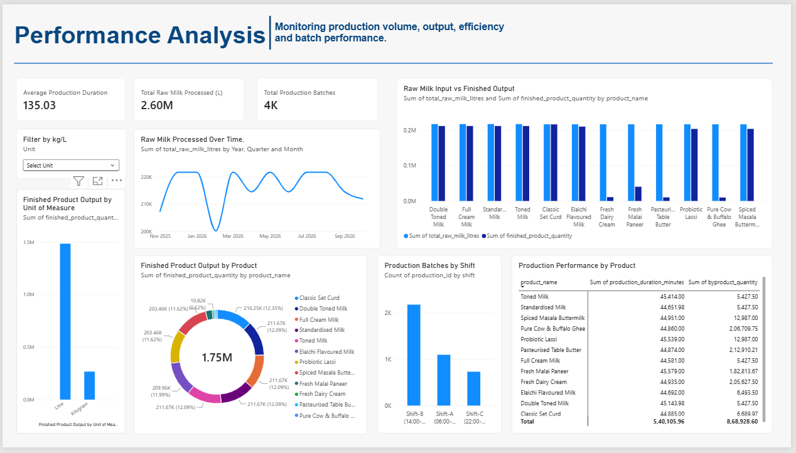

Average Production Duration 135.03 minutes, Total Raw Milk Processed 2.60M L, Total Production Batches 4,000.

### Page 4 - Sales Analysis

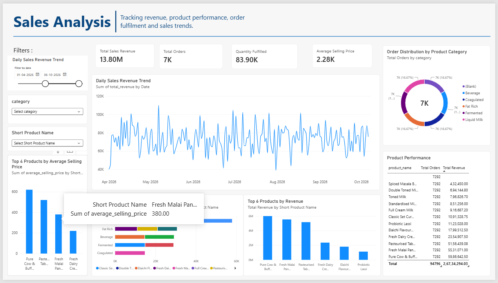

Captured with the date filter 01-04-2026 to 06-10-2026 active, so the cards read Total Sales Revenue 13.80M, Total Orders 7K, Quantity Fulfilled 83.90K. These are filtered values for that date range, not the full-period totals.

## Database

PostgreSQL 18.6, database `dairychain`, on localhost port 5432. Three schemas hold the Medallion layers: Bronze 10 tables, Silver 10 tables, Gold 6 tables, 26 tables in total.

### Connection and schemas

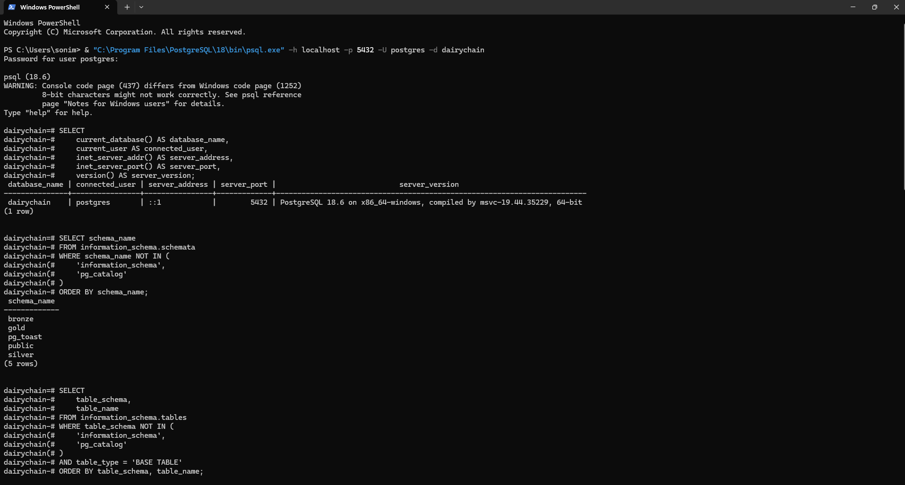

The psql connection to the `dairychain` database, with the bronze, gold, and silver schemas listed.

### Table inventory

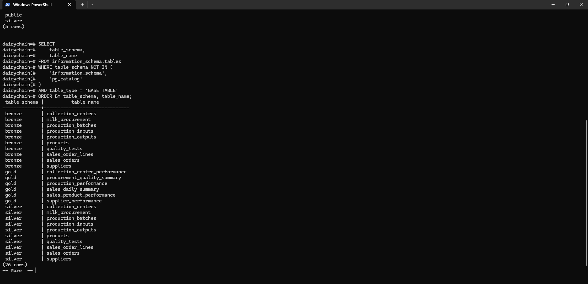

All 26 tables: 10 in Bronze, 10 in Silver, 6 in Gold.

### Gold row counts

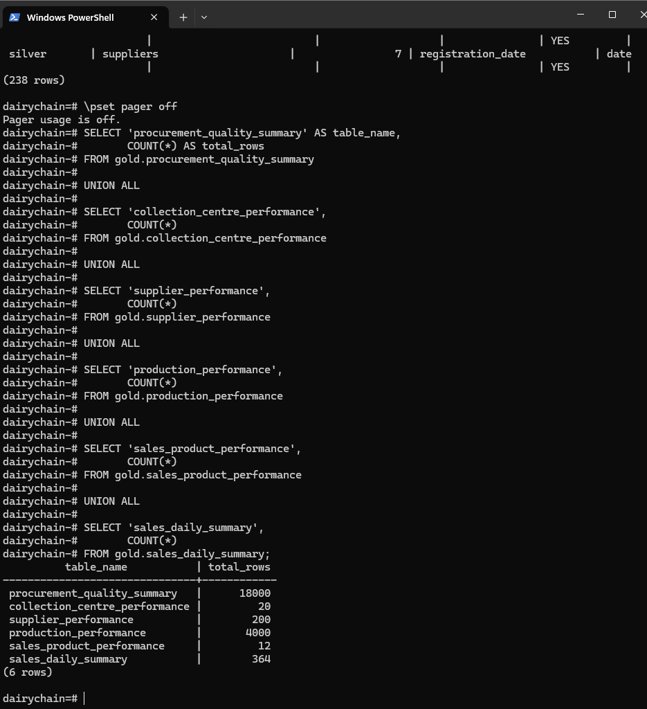

Row counts from a COUNT(*) query on the 6 Gold tables, 22,596 rows in total.

### Power BI model view

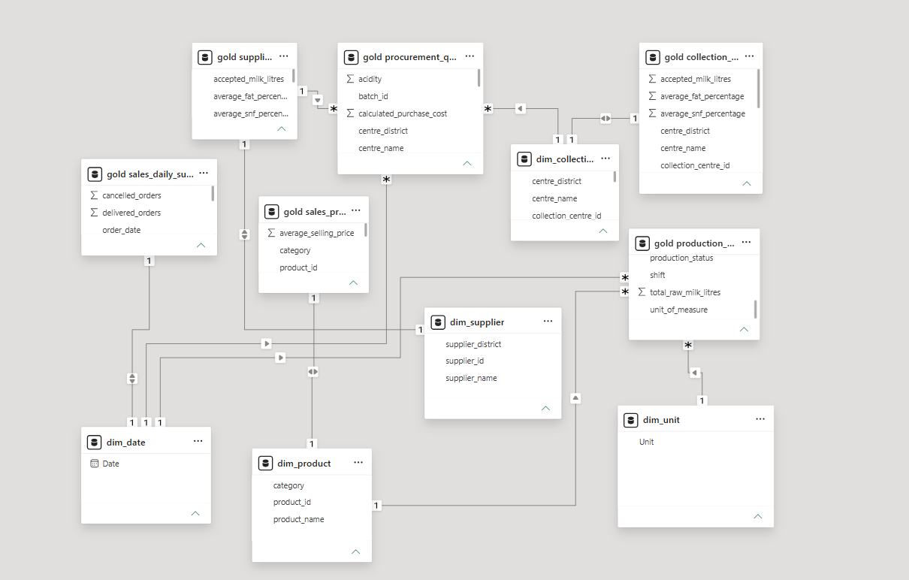

Power BI model view as shown in Power BI Desktop.

## Medallion Architecture

### Data Engineering Pipeline Using the Medallion Architecture

DairyChain follows the Medallion Architecture, implemented using PostgreSQL with three logical data layers:

1. Bronze - Raw Layer: Stores the original source data in 10 PostgreSQL tables (99,584 rows).
2. Silver - Structured Layer: Contains structured and typed data in 10 PostgreSQL tables (99,584 rows).
3. Gold - Business Layer: Contains business-oriented analytical tables in 6 PostgreSQL tables (22,596 rows).

Flow: Source CSV Files -> Python Ingestion -> PostgreSQL Medallion Architecture (Bronze -> Silver -> Gold) -> Power BI.

Bronze, Silver, and Gold are three schemas inside ONE large PostgreSQL database, `dairychain`, not three separate databases.

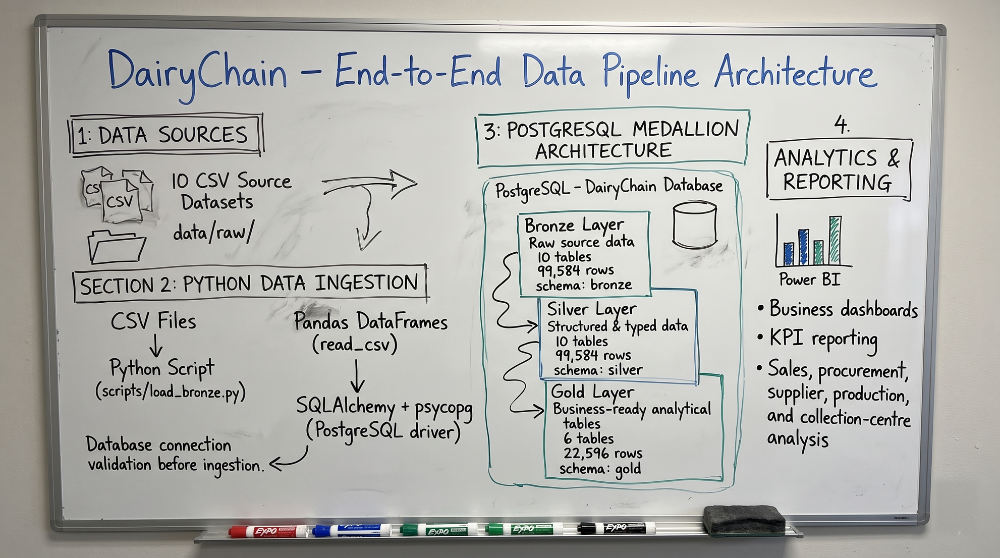

The image above is the user-supplied architecture whiteboard (Source 27, 2026-11-11). It is an illustration of the intended pipeline. The whiteboard picture names load_bronze.py, SQLAlchemy + psycopg, read_csv, and connection validation. The build described here uses the Colab notebook and the CSV files.

The same flow as a clean diagram:

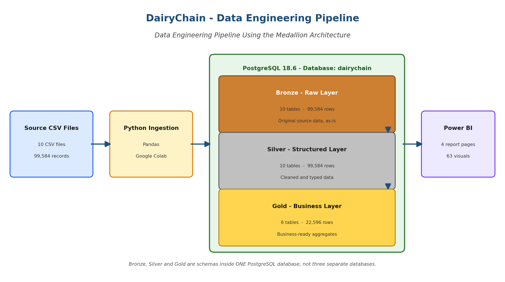

DairyChain uses the Medallion Architecture: Bronze, then Silver, then Gold. Data is refined one layer at a time, and each layer has a different job.

| Layer | Schema | Purpose | Tables | Rows |
|---|---|---|---|---:|
| Bronze | `bronze` | Raw ingestion as-is: the source CSV data loaded into PostgreSQL without cleaning | 10 | 99,584 |
| Silver | `silver` | Cleaned and typed: the same records with proper data types and cleaning applied | 10 | 99,584 |
| Gold | `gold` | Business-ready aggregates: analytical tables built for reporting in Power BI | 6 | 22,596 |

The layer inventory is shown: table names by Source 17 (psql table inventory, 26 rows), column names and types by Source 18 (238 columns: Bronze 82, all text; Silver 83, typed; Gold 73, typed), Gold row counts by Source 19 (live database COUNT(*), total 22,596), and Bronze and Silver row totals by Source 25 (given by the user database totals, 99,584 each). Silver kept all 99,584 rows, so cleaning dropped 0 rows at the Bronze-to-Silver step.

The Colab notebook (Source 15) shows pandas validation and transformation logic. It is the notebook's pandas work, not the database transformation. The full Medallion design is in [docs/02_System_Architecture/system_architecture.md](docs/02_System_Architecture/system_architecture.md), [docs/02_System_Architecture/database_design.md](docs/02_System_Architecture/database_design.md), [docs/02_System_Architecture/data_dictionary.md](docs/02_System_Architecture/data_dictionary.md), and [docs/03_Data_Engineering/bronze_silver_gold_layers.md](docs/03_Data_Engineering/bronze_silver_gold_layers.md).

## Business Problem
Dairy supply chains involve many connected stages, and reading each stage alone hides where losses occur. DairyChain joins procurement, quality, production and sales so a manager can see where milk is lost, how production performs, and which products contribute most to revenue. Learn more in [docs/00_Project_Overview/project_summary.md](docs/00_Project_Overview/project_summary.md) - the one-page summary - and [docs/00_Project_Overview/business_context.md](docs/00_Project_Overview/business_context.md) - the dairy workflow.

## Requirements
The business needs procurement, quality, production and sales analysis, with a structured analytical model for reporting. Learn what was asked for in [docs/01_Business_Requirements/business_requirements.md](docs/01_Business_Requirements/business_requirements.md), what the system must do in [docs/01_Business_Requirements/functional_requirements.md](docs/01_Business_Requirements/functional_requirements.md), the quality limits in [docs/01_Business_Requirements/non_functional_requirements.md](docs/01_Business_Requirements/non_functional_requirements.md), and the assumptions in [docs/01_Business_Requirements/assumptions_and_constraints.md](docs/01_Business_Requirements/assumptions_and_constraints.md).

## System Design
The design is layered: CSV to Python to PostgreSQL, then Bronze, Silver and Gold, then Power BI. Learn the design in [docs/02_System_Architecture/system_architecture.md](docs/02_System_Architecture/system_architecture.md), follow a record in [docs/02_System_Architecture/data_flow.md](docs/02_System_Architecture/data_flow.md), see the layer design in [docs/02_System_Architecture/database_design.md](docs/02_System_Architecture/database_design.md), and check the named tables in [docs/02_System_Architecture/data_dictionary.md](docs/02_System_Architecture/data_dictionary.md).

## Data Engineering
Raw CSV data becomes clean, report-ready tables in three layers. Learn ingestion in [docs/03_Data_Engineering/data_ingestion.md](docs/03_Data_Engineering/data_ingestion.md), validation in [docs/03_Data_Engineering/data_validation.md](docs/03_Data_Engineering/data_validation.md), cleaning in [docs/03_Data_Engineering/data_cleaning.md](docs/03_Data_Engineering/data_cleaning.md), transformation in [docs/03_Data_Engineering/transformation_logic.md](docs/03_Data_Engineering/transformation_logic.md), the layers in [docs/03_Data_Engineering/bronze_silver_gold_layers.md](docs/03_Data_Engineering/bronze_silver_gold_layers.md), and execution in [docs/03_Data_Engineering/pipeline_execution.md](docs/03_Data_Engineering/pipeline_execution.md).

## Python and SQL
Python does ingestion and processing with Pandas. SQL does relational analysis in PostgreSQL. Learn the Python patterns in [docs/07_AI_Assisted_Development/python_development.md](docs/07_AI_Assisted_Development/python_development.md), the SQL patterns in [docs/07_AI_Assisted_Development/sql_development.md](docs/07_AI_Assisted_Development/sql_development.md), and the method that joins them in [docs/04_Business_Analytics/analytics_methodology.md](docs/04_Business_Analytics/analytics_methodology.md).

## Business Analytics
Analytics follows one method for every question, with the same KPI names and formulas everywhere. Learn the method in [docs/04_Business_Analytics/analytics_methodology.md](docs/04_Business_Analytics/analytics_methodology.md), the KPI definitions in [docs/04_Business_Analytics/kpi_definitions.md](docs/04_Business_Analytics/kpi_definitions.md), procurement in [docs/04_Business_Analytics/procurement_analysis.md](docs/04_Business_Analytics/procurement_analysis.md), production in [docs/04_Business_Analytics/production_analysis.md](docs/04_Business_Analytics/production_analysis.md), and sales in [docs/04_Business_Analytics/sales_analysis.md](docs/04_Business_Analytics/sales_analysis.md). Profitability, inventory, outlets and expenses are covered in [docs/04_Business_Analytics/profitability_analysis.md](docs/04_Business_Analytics/profitability_analysis.md), [docs/04_Business_Analytics/inventory_analysis.md](docs/04_Business_Analytics/inventory_analysis.md), [docs/04_Business_Analytics/outlet_analysis.md](docs/04_Business_Analytics/outlet_analysis.md) and [docs/04_Business_Analytics/expense_analysis.md](docs/04_Business_Analytics/expense_analysis.md), with their limits stated.

## Questions and Actual Answers
Every business question is answered in the same format, with its result. Start at [docs/05_Business_Questions_and_Answers/README.md](docs/05_Business_Questions_and_Answers/README.md), then read the 13 numbered files, from [docs/05_Business_Questions_and_Answers/01_profitability_questions.md](docs/05_Business_Questions_and_Answers/01_profitability_questions.md) to [docs/05_Business_Questions_and_Answers/13_management_recommendations.md](docs/05_Business_Questions_and_Answers/13_management_recommendations.md).

## Business Findings
The supplied numbers support three findings: rejection is about 1 in 8, fulfilment is incomplete on about 1 in 5 orders, and production output must stay split by unit. Learn them in [docs/06_Business_Findings_and_Impact/executive_summary.md](docs/06_Business_Findings_and_Impact/executive_summary.md) and [docs/06_Business_Findings_and_Impact/key_findings.md](docs/06_Business_Findings_and_Impact/key_findings.md), with profit and loss in [docs/06_Business_Findings_and_Impact/profit_and_loss_insights.md](docs/06_Business_Findings_and_Impact/profit_and_loss_insights.md), operations in [docs/06_Business_Findings_and_Impact/operational_insights.md](docs/06_Business_Findings_and_Impact/operational_insights.md), and limits in [docs/06_Business_Findings_and_Impact/limitations_and_future_analysis.md](docs/06_Business_Findings_and_Impact/limitations_and_future_analysis.md).

## Management Recommendations
Management should investigate rejection first, then fulfilment, then supply the cost inputs before any profit decision. Learn the actions in [docs/06_Business_Findings_and_Impact/recommendations.md](docs/06_Business_Findings_and_Impact/recommendations.md) and [docs/05_Business_Questions_and_Answers/13_management_recommendations.md](docs/05_Business_Questions_and_Answers/13_management_recommendations.md).

## AI-assisted development
AI was used as an assistant, with the developer in charge of every decision. Learn the workflow in [docs/07_AI_Assisted_Development/README.md](docs/07_AI_Assisted_Development/README.md), the method in [docs/07_AI_Assisted_Development/development_workflow.md](docs/07_AI_Assisted_Development/development_workflow.md) and [docs/07_AI_Assisted_Development/how_ai_was_used.md](docs/07_AI_Assisted_Development/how_ai_was_used.md), prompts in [docs/07_AI_Assisted_Development/prompt_engineering.md](docs/07_AI_Assisted_Development/prompt_engineering.md), review in [docs/07_AI_Assisted_Development/code_review.md](docs/07_AI_Assisted_Development/code_review.md), debugging in [docs/07_AI_Assisted_Development/debugging_with_ai.md](docs/07_AI_Assisted_Development/debugging_with_ai.md), and testing in [docs/07_AI_Assisted_Development/testing_with_ai.md](docs/07_AI_Assisted_Development/testing_with_ai.md).

## Testing
Testing has four levels: unit, integration, SQL validation and data quality.

## Debugging
Debugging follows a fixed 12-step workflow, from observing the error to recording the fix. Learn it in [docs/08_Debugging_and_Troubleshooting/debugging_methodology.md](docs/08_Debugging_and_Troubleshooting/debugging_methodology.md), the real errors in [docs/08_Debugging_and_Troubleshooting/errors_and_fixes.md](docs/08_Debugging_and_Troubleshooting/errors_and_fixes.md), and the log in [docs/08_Debugging_and_Troubleshooting/troubleshooting_log.md](docs/08_Debugging_and_Troubleshooting/troubleshooting_log.md).

## Security
Security is stated as implemented controls against recommended controls, so a recommendation is never mistaken for a control that exists. Learn the review in [docs/10_Security_and_Reliability/security_review.md](docs/10_Security_and_Reliability/security_review.md), SQL injection prevention in [docs/10_Security_and_Reliability/sql_injection_prevention.md](docs/10_Security_and_Reliability/sql_injection_prevention.md), credentials in [docs/10_Security_and_Reliability/credential_management.md](docs/10_Security_and_Reliability/credential_management.md), access in [docs/10_Security_and_Reliability/access_control.md](docs/10_Security_and_Reliability/access_control.md), and transactions in [docs/10_Security_and_Reliability/transaction_and_data_integrity.md](docs/10_Security_and_Reliability/transaction_and_data_integrity.md).

## Performance
Performance is judged by measurement, not by feeling. Learn query optimisation in [docs/11_Performance_Optimization/query_optimization.md](docs/11_Performance_Optimization/query_optimization.md), Python optimisation in [docs/11_Performance_Optimization/python_optimization.md](docs/11_Performance_Optimization/python_optimization.md), and pipeline performance in [docs/11_Performance_Optimization/pipeline_performance.md](docs/11_Performance_Optimization/pipeline_performance.md).

## Engineering Decisions
The decisions record why Python, SQL, PostgreSQL and the three layers were chosen, and what was rejected. Learn them in [docs/12_Engineering_Decisions/README.md](docs/12_Engineering_Decisions/README.md), [docs/12_Engineering_Decisions/python_and_sql_decisions.md](docs/12_Engineering_Decisions/python_and_sql_decisions.md), [docs/12_Engineering_Decisions/database_decisions.md](docs/12_Engineering_Decisions/database_decisions.md), [docs/12_Engineering_Decisions/architecture_decisions.md](docs/12_Engineering_Decisions/architecture_decisions.md) and [docs/12_Engineering_Decisions/rejected_approaches.md](docs/12_Engineering_Decisions/rejected_approaches.md).

## Evidence
Evidence is the final check. Learn what is implemented in [docs/13_Project_Evidence/implementation_status.md](docs/13_Project_Evidence/implementation_status.md), the query references in [docs/13_Project_Evidence/query_references.md](docs/13_Project_Evidence/query_references.md), the screenshots and reports in [docs/13_Project_Evidence/screenshots_and_reports.md](docs/13_Project_Evidence/screenshots_and_reports.md), and the check record in [docs/13_Project_Evidence/verification_record.md](docs/13_Project_Evidence/verification_record.md). The full source list is in [VERIFICATION_AND_MISSING_INFO.md](VERIFICATION_AND_MISSING_INFO.md).

## Glossary
Terms are defined once and used the same way everywhere. See [docs/14_Glossary/business_terms.md](docs/14_Glossary/business_terms.md), [docs/14_Glossary/analytics_terms.md](docs/14_Glossary/analytics_terms.md) and [docs/14_Glossary/technical_terms.md](docs/14_Glossary/technical_terms.md).

## README placement - recommended order, not completed
Source: the user-supplied "DairyChain - Architecture Diagrams" document (Source 12, 2026-11-11, section 9). This is a recommended order for the README, labelled as a plan.

Recommended order:

1. Project banner.
2. Project introduction.
3. System architecture diagram.
4. Data-processing pipeline diagram.
5. Technology stack.
6. Power BI dashboard screenshots.
7. Links to detailed architecture documentation.

The database layer and reporting architecture diagrams can appear in the detailed documentation, with optional thumbnails or links in the README. The diagram index, with the Mermaid sources, is in [docs/13_Project_Evidence/screenshots_and_reports.md](docs/13_Project_Evidence/screenshots_and_reports.md).


## Next step / Related files
- [docs/README.md](docs/README.md)
- [VERIFICATION_AND_MISSING_INFO.md](VERIFICATION_AND_MISSING_INFO.md)
- [docs/00_Project_Overview/project_summary.md](docs/00_Project_Overview/project_summary.md)
