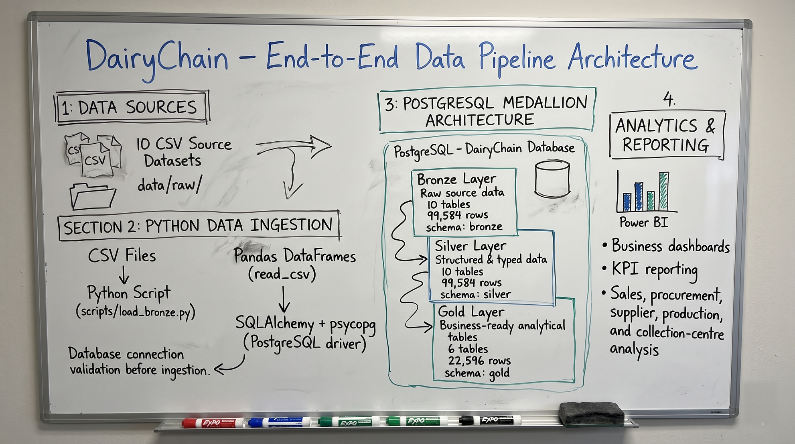
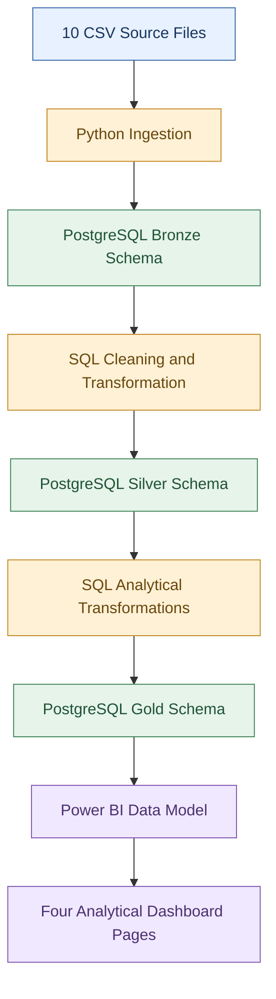
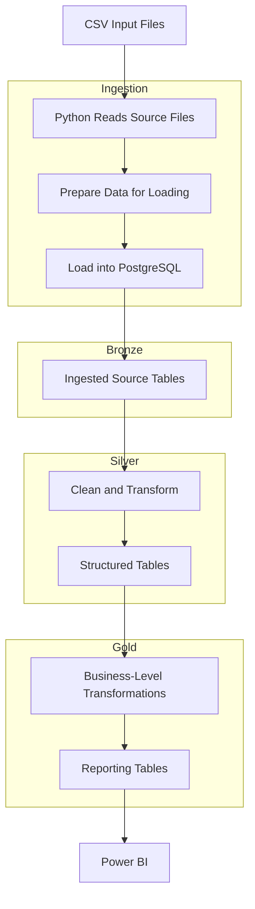

# Data Flow

## Purpose
This file answers how a single record travels from a CSV file to a Power BI visual. It is for a reader who wants to trace a number back to its source.

## In this file
- The flow, step by step
- Medallion flow
- Data flow architecture
- Data flow responsibilities
- What changes at each step
- Where a number can be checked

## The flow, step by step
1. Operational CSV files: 10 files, 99,584 records in total.
2. Python ingestion: read, check and load the CSV data into PostgreSQL.
3. Bronze layer: store the ingested source data.
4. Silver layer: clean and structure the data into 10 tables.
5. Gold layer: build 6 analytical tables for reporting.
6. Power BI: read the Gold tables and show four report pages.
7. Business intelligence and analysis: a manager reads the report and acts on it.

## Medallion flow
DairyChain uses the Medallion Architecture: Bronze, then Silver, then Gold. A record travels through the layers in that order, and each layer refines it once.

Flow: Source CSV Files -> Python Ingestion -> PostgreSQL Medallion Architecture (Bronze -> Silver -> Gold) -> Power BI. Bronze, Silver, and Gold are three schemas inside ONE PostgreSQL database, `dairychain`, not three separate databases.

The image above is the user-supplied architecture whiteboard (Source 27, 2026-11-11). It is an illustration of the intended pipeline. The whiteboard picture names load_bronze.py, SQLAlchemy + psycopg, read_csv, and connection validation. The build described here uses the Colab notebook and the CSV files.

| Layer | Schema | Tables | Rows | What changes |
|---|---|---|---|---:|
| Bronze | `bronze` | 10 | 99,584 | Nothing: raw ingestion as-is, every column `text` |
| Silver | `silver` | 10 | 99,584 | Cleaning and typing: proper data types, 0 rows dropped |
| Gold | `gold` | 6 | 22,596 | Grain change: batches become supplier, centre, product and daily summaries |

The layer inventory is shown: schemas and table names by Source 17, column names and types by Source 18 (Bronze 82 columns, all `text`; Silver 83, typed; Gold 73, typed), Gold row counts by Source 19, Bronze and Silver row totals from Source 25. The notebook (Source 15) shows pandas validation and transformation logic, but it has no SQL and no Bronze load, so it must not be read as the database transformation.

## End-to-end pipeline view
The following diagram is the end-to-end pipeline view from the Data Ingestion and Transformation Pipeline document (Source 9). It shows the same flow at pipeline level, from source files to dashboard pages.

| Stage | Technology | Responsibility |
|---|---|---|
| Extract | CSV files and Python | Read the source files |
| Load | Python and PostgreSQL | Load source records into Bronze |
| Transform 1 | SQL | Clean and structure data in Silver |
| Transform 2 | SQL | Prepare analytical tables in Gold |
| Report | Power BI | Analyse and visualise the resulting data |

## Data flow architecture
The following diagram explains the transformation path across the database layers.

## Data flow responsibilities
| Stage | Input | Output |
|---|---|---|
| Python ingestion | CSV files | Loaded PostgreSQL Bronze tables |
| Bronze processing | Ingested records | Source tables available for transformation |
| Silver transformation | Bronze tables | Cleaned Silver tables |
| Gold transformation | Silver tables | Analytical Gold tables |
| Power BI | Gold tables | Dashboard visuals and business metrics |

This diagram represents the documented logical flow. It does not imply that a scheduler, cloud service, or orchestration platform runs the pipeline automatically. No scheduler, cloud service, or orchestration platform is claimed as implemented. See [pipeline_execution.md](../03_Data_Engineering/pipeline_execution.md).

## What changes at each step
- Ingestion should not change business values. It should only move them and record what arrived.
- Silver may fix types, remove duplicates and handle missing values. Each fix must be logged, or the Gold result cannot be trusted.
- Gold changes grain: batches become supplier, centre, product and daily summaries. The grain of each Gold table is named in [data_dictionary.md](data_dictionary.md).

## Where a number can be checked
- Procurement totals can be checked at Bronze, then Silver, then procurement_quality_summary.
- Production totals can be checked the same way through production_performance.
- Sales totals can be checked through sales_product_performance and sales_daily_summary. The check list is in [../03_Data_Engineering/data_validation.md](../03_Data_Engineering/data_validation.md).

## Next step / Related files
- [System architecture](system_architecture.md)
- [Pipeline execution](../03_Data_Engineering/pipeline_execution.md)
- [Data dictionary](data_dictionary.md)
