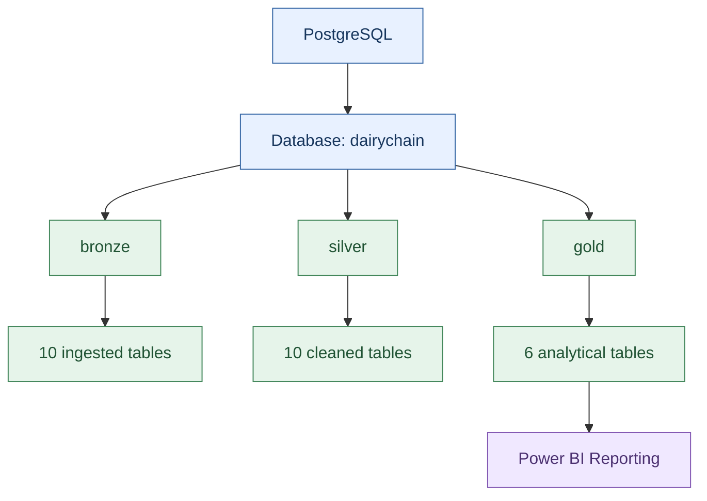
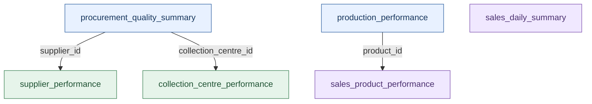

# Database Design

## Purpose
This file answers how the database is organised into Bronze, Silver and Gold, what each Gold table contains, and what is known and not known about keys, constraints, and indexes. It is for a reader who needs the data model before writing a query. Source: the user-supplied "DairyChain - Database Architecture" document (Source 10, 2026-11-11).

## In this file
- Database environment
- Database schema architecture
- Medallion architecture
- Bronze layer
- Silver layer
- Gold layer
- Database-level relationships
- Power BI relationship mapping (Source 11)
- Power BI model - from Source 23 (pbixray)
- Primary keys, constraints, and indexes
- Database design considerations
- Current database scope and limitations
- Constraints

## Database environment
PostgreSQL acts as the central database for storing and processing the project's data. The database is organised around the data-processing requirements of procurement, milk quality, production, and sales analytics.

| Property | Details |
|---|---|
| Database system | PostgreSQL |
| Database version recorded during development | PostgreSQL 18.6 |
| Database name | `dairychain` |
| Main schemas | `bronze`, `silver`, `gold` |
| Reporting tool | Microsoft Power BI |

PostgreSQL 18.6 was confirmed by Source 8 and confirmed again by Source 10. Source 16 records the same version as a psql client version output: `psql --version` in PowerShell returned `psql (PostgreSQL) 18.6`, which shows the client executable only. Source 17 now shows the server version as well: a successful psql connection to database `dairychain` on localhost port 5432 as user `postgres` returned one row, `dairychain | postgres | ::1 | 5432 | PostgreSQL 18.6 on x86_64-windows, compiled by msvc-19.44.35229, 64-bit`. See the screenshots in [screenshots_and_reports.md](../13_Project_Evidence/screenshots_and_reports.md). The connection test is DONE. Source 18 now shows column names, data types, precision, scale, and nullability for all 26 tables (238 columns): see [data_dictionary.md](data_dictionary.md). Bronze and Silver row totals are now from Source 25 (99,584 each). Indexes are absent in Source 21 (see the constraints and indexes section below). Constraints are now absent in Source 20: a `pg_constraint` query over bronze, silver, and gold returned 0 rows, so no primary key, foreign key, unique, or check constraint exists on any of the 26 tables. Gold row counts are now from Source 19 (18,000, 20, 200, 4,000, 12, 364, total 22,596). Source 23 read the.pbix model with pbixray: 23 DAX measures (21 with formulas, 2 empty), 1 relationship, Power Query loads only the 6 Gold tables from localhost:5432, and model-data totals read with pbixray get_table check the README KPI values.

## Database schema architecture
The database is organised into three schemas, each with a different responsibility in the data-processing workflow. The objective is to separate ingested data, cleaned data, and reporting-ready analytical data.

### Schema responsibilities
| Schema | Purpose | Recorded tables |
|---|---|---:|
| `bronze` | Stores ingested source data | 10 |
| `silver` | Stores cleaned and transformed data | 10 |
| `gold` | Stores analytical and reporting tables | 6 |

## Medallion architecture
DairyChain uses the Medallion Architecture: Bronze, then Silver, then Gold. The three schemas above are the three Medallion layers, all inside the `dairychain` database on PostgreSQL 18.6.

| Layer | Schema | Purpose | Tables | Rows | Columns | Types |
|---|---|---|---|---:|---:|---|
| Bronze | `bronze` | Raw ingestion as-is: source CSV data loaded without cleaning | 10 | 99,584 | 82 | All `text` |
| Silver | `silver` | Cleaned and typed: the same records with proper data types and cleaning applied | 10 | 99,584 | 83 | Typed |
| Gold | `gold` | Business-ready aggregates: analytical tables for reporting | 6 | 22,596 | 73 | Typed |

Evidence for the inventory: schemas and table names from Source 17 (psql schema query and table inventory, 26 rows); column names and types from Source 18 (238 columns); Gold row counts from Source 19 (live database COUNT(*), 18,000, 20, 200, 4,000, 12, 364, total 22,596); Bronze and Silver row totals from Source 25 (99,584 each). Silver kept all 99,584 rows, so cleaning dropped 0 rows at the Bronze-to-Silver step. Bronze and Silver hold the same 10 table names; Gold holds 6 different tables, listed in the Gold layer section below.

The Colab notebook (Source 15) shows pandas validation and transformation logic in Colab. The notebook uses pandas, os, zipfile, google.colab, and matplotlib only.

## Bronze layer

**Purpose:** Maintain the data ingested from the source files.

Recorded characteristics:

- 10 tables, names from Source 17 (psql table inventory, 26 rows total across bronze, gold, and silver).

The Bronze layer provides the initial database representation of the input data and the starting point for database-level cleaning and transformations. Bronze table names, from Source 17:

| Bronze table |
|---|
| `collection_centres` |
| `milk_procurement` |
| `production_batches` |
| `production_inputs` |
| `production_outputs` |
| `products` |
| `quality_tests` |
| `sales_order_lines` |
| `sales_orders` |
| `suppliers` |

This confirms `bronze.milk_procurement`, which Source 16 used in its examples. It resolves the Source 16 conflict note: the real name is `milk_procurement`, not the illustrative `bronze.procurement` from Source 9. Bronze columns are now from Source 18 (82 columns in total): every Bronze column is data_type `text`, is_nullable YES, with no column_default shown. Full column tables are in [data_dictionary.md](data_dictionary.md).

## Silver layer

**Purpose:** Store cleaned and transformed data.

Recorded characteristics:

- 10 tables, names from Source 17. The Silver list is identical to the Bronze list: `collection_centres`, `milk_procurement`, `production_batches`, `production_inputs`, `production_outputs`, `products`, `quality_tests`, `sales_order_lines`, `sales_orders`, `suppliers`.

The Silver layer represents the next stage of processing, where data is structured for downstream analytical transformations. Column definitions are now from Source 18 (83 columns in total): Silver is typed, unlike Bronze. Examples: `collection_centres.operating_capacity_litres` integer, opening and closing time as time without time zone; `milk_procurement.quantity_litres` numeric(12,2); `quality_tests` fat, SNF, temperature, and acidity numeric(6,3); `suppliers.registration_date` date. Two differences from Bronze are shown: Silver `milk_procurement` has 13 columns, adding `calculated_purchase_cost`, `cost_difference`, and `cost_status`; Silver `suppliers` has only 7 columns, without `status` and `contact_reference`, which Bronze `suppliers` has. Full column tables are in [data_dictionary.md](data_dictionary.md).

## Gold layer

**Purpose:** Provide analytical tables that support reporting and business analysis.

The Gold schema contains six tables, and their existence is now from Source 17 (all six appear in the psql table inventory). These tables do not all have the same level of detail: some represent individual business records, while others contain aggregated performance metrics. Unlike a single transaction table, the Gold schema contains tables with different levels of detail, so understanding grain is important for writing correct SQL and defining Power BI measures.

| Gold table | Recorded rows | Grain |
|---|---:|---|
| `procurement_quality_summary` | 18,000 | One row per procurement batch |
| `collection_centre_performance` | 20 | One row per collection centre |
| `supplier_performance` | 200 | One row per supplier |
| `production_performance` | 4,000 | One row per production batch |
| `sales_product_performance` | 12 | One row per product |
| `sales_daily_summary` | 364 | One row per date |

The Gold tables support reporting across procurement and quality, collection centres, suppliers, production, product sales, and daily sales. Total Gold records: 22,596. Full column lists for all six tables are in [data_dictionary.md](data_dictionary.md).

## Database-level relationships
The Gold tables represent different business entities and aggregation levels. The following conceptual diagram shows the connections between detailed procurement and the supplier and collection-centre summaries, as well as the sales and production domains.

**Important:** This is a conceptual entity relationship view, not a claim that all these physical foreign-key constraints have been created in PostgreSQL. Indexes are absent in Source 21: a `pg_index` query over bronze, silver, and gold returned 0 rows, so no index exists on any table.

## Power BI relationship mapping (Source 11)
Source: the user-supplied "DairyChain - Power BI Data Model" document (Source 11, 2026-11-11, section 5). This is the documented intended relationship mapping for the Power BI model, not a shown PBIX configuration. The 11 model tables in the mapping are now from Source 22 (all 6 Gold tables and all 5 dimensions appear in the DiagramLayout of the supplied.pbix). Source 23 (pbixray) shown the actual relationships: only one exists in the model - see the check block after the table below. The 10-row mapping above is the intended design, not the model.

| Dimension | Reporting table | Key columns | Intended cardinality |
|---|---|---|---|
| dim_date | sales_daily_summary | Date to order_date | 1:1 |
| dim_date | procurement_quality_summary | Date to procurement_date | 1:* |
| dim_date | production_performance | Date to production_date | 1:* |
| dim_product | sales_product_performance | product_id | 1:1 |
| dim_product | production_performance | product_id | 1:* |
| dim_supplier | supplier_performance | supplier_id | 1:1 |
| dim_supplier | procurement_quality_summary | supplier_id | 1:* |
| dim_collection_centre | collection_centre_performance | collection_centre_id | 1:1 |
| dim_collection_centre | procurement_quality_summary | collection_centre_id | 1:* |
| dim_unit | production_performance | Unit to unit_of_measure | 1:* |

### Source 23 - relationships in the model: 1 exists
Pbixray `relationships` returns exactly one row: `gold procurement_quality_summary[supplier_id]` to `gold supplier_performance[supplier_id]`, IsActive 1, Cardinality M:1, CrossFilteringBehavior Single, FromKeyCount 203, RelyOnReferentialIntegrity 0. None of the 10 intended dimension relationships in the table above exists in the model. The single relationship that does exist is a fact-to-fact link between the two Gold tables on `supplier_id`; it is not one of the documented dimension relationships, and it is not via `dim_supplier`. Do not invent the missing relationships.

Cardinality must be confirmed from actual unique-key and relationship properties. A one-to-one relationship is appropriate only when both join columns are unique and complete for the intended relationship.

Recommended filter direction: where the model uses one-to-many relationships, the intended filtering direction is Dimension table to Reporting table. This helps keep filtering predictable and reduces the need for bidirectional relationships. The final Power BI configuration should be checked rather than assumed from this documentation.

Note on `procurement_date` and `production_date`: Source 11, section 4.1, explains that these are date-level fields derived from the relevant timestamps. The exact formulas are DAX calculated columns in the model: `procurement_date` = DATE(YEAR(procurement_timestamp), MONTH(procurement_timestamp), DAY(procurement_timestamp)) and `production_date` = DATE(YEAR(production_start), MONTH(production_start), DAY(production_start)). They are NOT columns in PostgreSQL. See [data_dictionary.md](data_dictionary.md) and [../04_Business_Analytics/analytics_methodology.md](../04_Business_Analytics/analytics_methodology.md).

## Primary keys, constraints, and indexes
Database constraints and indexes are important for data integrity and performance. Constraints are now absent in Source 20: a `pg_constraint` query over bronze, silver, and gold returned 0 rows, so no primary key, foreign key, unique, or check constraint exists on any of the 26 tables. This is consistent with Source 18, where all 238 columns are nullable YES with no column default. Indexes are absent in Source 21: a `pg_index` query over bronze, silver, and gold returned 0 rows, so no index exists on any table. Nothing in this section is claimed as implemented, except the shown absence of constraints and indexes stated here. Source: [postgresql-constraints-zero-rows.png](../13_Project_Evidence/postgresql-constraints-zero-rows.png) and [postgresql-indexes-zero-rows.png](../13_Project_Evidence/postgresql-indexes-zero-rows.png).

### Primary keys
Identify the unique identifier for each table. Possible business identifier candidates, based on the documented table grain, include:

- `procurement_id`
- `collection_centre_id`
- `supplier_id`
- `production_id`
- `product_id`
- `order_date`

These are candidates based on the documented table grain, as a design proposal only. Source 20 shows their database constraints: none of them is a primary key, because no primary key constraint exists on any table in bronze, silver, or gold. Do not treat a candidate as a confirmed primary key.

### Foreign keys
Check whether relevant identifiers reference corresponding parent entities.

### Uniqueness
Check uniqueness where the table grain requires one record per identifier or date.

### Indexes
Examine indexes on frequently used join keys, filtering columns, and date fields. Do not claim that an index exists merely because a column is used in a relationship.

## Database design considerations
- Separation of processing layers: Bronze, Silver, and Gold make it easier to distinguish ingestion, cleaning, and analytical preparation.
- Clear table grain: every Gold table has an intended business level of detail. Understanding this grain helps avoid double counting.
- Consistent identifiers: supplier, product, collection-centre, and date identifiers are important for connecting different areas of the reporting model.
- Measurement consistency: production quantities should retain their units of measurement throughout SQL transformations and Power BI reporting. Litres and kilograms must not be added together.
- Business definitions: column names alone do not define a business metric. For example, rejection rate must specify whether it measures rejected batches or rejected milk volume.

## Current database scope and limitations
The database architecture documented here covers the current recorded PostgreSQL implementation. The following must not be claimed without additional database evidence.

- Foreign-key constraints on all identifier columns. absent in Source 20: a `pg_constraint` query over bronze, silver, and gold returned 0 rows, so no foreign-key constraint exists on any table.
- Indexes on every join or filter column. absent in Source 21: a `pg_index` query over bronze, silver, and gold returned 0 rows, so no index exists on any table. Adding indexes is a future improvement, not current state.
- Partitioning.
- Materialized views.
- Stored procedures.
- Automated incremental loading.
- Automated database backups.
- Replication or high availability.
- Cloud-hosted PostgreSQL deployment.

These may be valuable future improvements, but they are separate from the recorded architecture.

## Constraints
Primary keys, foreign keys, unique constraints, and check constraints are confirmed absent by Source 20: a `pg_constraint` query over bronze, silver, and gold returned 0 rows. Indexes are absent in Source 21: a `pg_index` query over bronze, silver, and gold returned 0 rows, so no index exists on any table. Candidate identifiers are listed above as design candidates only, not as existing constraints. Column data types and nullability are now from Source 18 and listed in [data_dictionary.md](data_dictionary.md): Bronze 82 columns (all text), Silver 83 columns (typed), Gold 73 columns (typed). The inspection queries to check the recorded inventory are in [../03_Data_Engineering/data_validation.md](../03_Data_Engineering/data_validation.md).

## Next step / Related files
- [Data dictionary](data_dictionary.md)
- [Data flow](data_flow.md)
- [System architecture](system_architecture.md)
- [Diagram index](../13_Project_Evidence/screenshots_and_reports.md)
- [Bronze Silver Gold](../03_Data_Engineering/bronze_silver_gold_layers.md)
- [Data validation](../03_Data_Engineering/data_validation.md)
