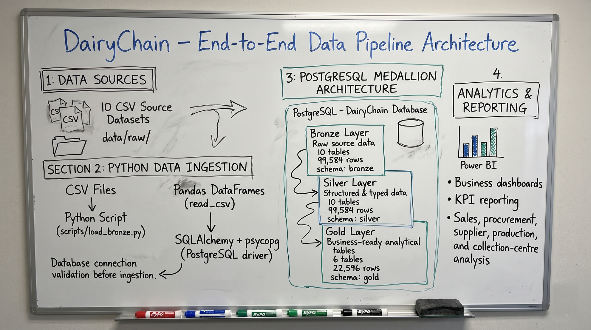
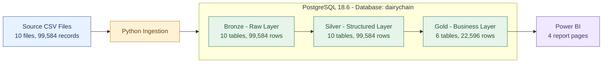
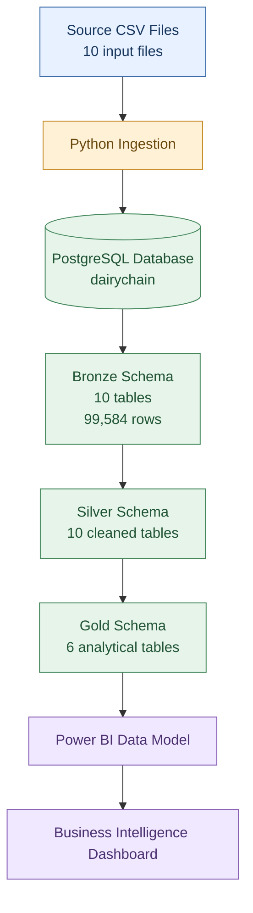

# System Architecture

## Purpose
This file answers how DairyChain is put together as a layered system and why each layer exists. It is for a reader who needs the design before the code or the queries.

## In this file
- Project overview
- Architecture at a glance
- Medallion architecture
- High-level system architecture
- Technology responsibilities
- Database design and data dictionary
- Diagrams
- Conclusion

## Project overview
DairyChain is a dairy supply chain analytics project designed to bring together information from four major business areas:

1. Milk procurement.
2. Milk quality.
3. Production.
4. Sales.

The project uses Python for data ingestion, PostgreSQL for data storage and transformation, SQL for analytical processing, and Power BI for reporting and business analysis.

The architecture follows a layered data-processing approach:

**Source Data -> Python Ingestion -> Bronze -> Silver -> Gold -> Power BI**

The objective is to organise the data into progressively refined layers so that it can be used for consistent business analysis and reporting.

## Architecture at a glance
| Layer / Component | Technology | Responsibility |
|---|---|---|
| Source | CSV files | Provide the input data |
| Ingestion | Python | Read and load source data into PostgreSQL |
| Database | PostgreSQL 18.6 | Store and manage the processing layers |
| Bronze | PostgreSQL | Maintain the ingested source tables |
| Silver | PostgreSQL and SQL | Store cleaned and transformed tables |
| Gold | PostgreSQL and SQL | Prepare analytical tables for reporting |
| Visualisation | Power BI | Present KPIs, trends, comparisons, and business insights |

The project database is named `dairychain`. It contains three main schemas: `bronze`, `silver`, and `gold`.

PostgreSQL version 18.6 is now confirmed by the user-supplied System Architecture document (Source 8, 2026-11-11).

## Medallion architecture

### Data Engineering Pipeline Using the Medallion Architecture

DairyChain follows the Medallion Architecture, implemented using PostgreSQL with three logical data layers:

1. Bronze - Raw Layer: Stores the original source data in 10 PostgreSQL tables (99,584 rows).
2. Silver - Structured Layer: Contains structured and typed data in 10 PostgreSQL tables (99,584 rows).
3. Gold - Business Layer: Contains business-oriented analytical tables in 6 PostgreSQL tables (22,596 rows).

Flow: Source CSV Files -> Python Ingestion -> PostgreSQL Medallion Architecture (Bronze -> Silver -> Gold) -> Power BI.

Bronze, Silver, and Gold are three schemas inside ONE large PostgreSQL database, `dairychain`, not three separate databases.

The image above is the user-supplied architecture whiteboard (Source 27, 2026-11-11). It is an illustration of the intended pipeline. The whiteboard picture names load_bronze.py, SQLAlchemy + psycopg, read_csv, and connection validation. The build described here uses the Colab notebook and the CSV files.

The same flow as a Mermaid diagram, with the three layers inside one PostgreSQL boundary:

DairyChain uses the Medallion Architecture: Bronze, then Silver, then Gold. Each layer is one PostgreSQL schema in the `dairychain` database, and data is refined one layer at a time.

| Layer | Schema | Purpose | Tables | Rows |
|---|---|---|---|---:|
| Bronze | `bronze` | Raw ingestion as-is: source CSV data loaded into PostgreSQL without cleaning | 10 | 99,584 |
| Silver | `silver` | Cleaned and typed: the same records with proper data types and cleaning applied | 10 | 99,584 |
| Gold | `gold` | Business-ready aggregates: analytical tables built for reporting in Power BI | 6 | 22,596 |

The three schemas are from Source 17 (psql schema query, 5 rows: bronze, gold, pg_toast, public, silver). The table lists per layer are from Source 17 (26 rows: Bronze and Silver hold the same 10 table names, Gold holds 6). Column names and types are from Source 18 (238 columns: Bronze 82, all `text`; Silver 83, typed; Gold 73, typed). Gold row counts are from Source 19 (live database COUNT(*), total 22,596). Bronze and Silver row totals are from Source 25 (99,584 each). Silver kept all 99,584 rows, so cleaning dropped 0 rows at the Bronze-to-Silver step.

The Colab notebook (Source 15) shows pandas validation and transformation logic, but it has no SQL and no Bronze load, so it must not be read as the database transformation. The layer design is detailed in [database_design.md](database_design.md) and [../03_Data_Engineering/bronze_silver_gold_layers.md](../03_Data_Engineering/bronze_silver_gold_layers.md).

## High-level system architecture
The following diagram represents the project's documented processing architecture.

### Architecture explanation

**Source files**

The pipeline starts with 10 CSV input files containing information needed for procurement, quality, production, and sales analysis.

**Python ingestion**

Python is used to read the source files and load the data into the PostgreSQL database.

**Bronze layer**

The Bronze schema maintains the ingested source tables. The recorded inventory contains 10 tables and 99,584 rows in total.

**Silver layer**

The Silver schema contains 10 cleaned tables. This layer represents the cleaned and transformed data used for further processing.

**Gold layer**

The Gold schema contains six analytical tables prepared for reporting.

**Power BI**

The Gold tables are used in the Power BI reporting model to create business KPIs, analytical visuals, and interactive dashboard pages.

## Technology responsibilities

### Python
Python is responsible for source-file ingestion and database loading. Its role is to move data into the database so that subsequent SQL processing can take place.

### PostgreSQL
PostgreSQL is the central storage and transformation environment. It contains the Bronze, Silver, and Gold schemas.

### SQL
SQL is used for database-level transformations and analytical queries. It also supports business questions such as procurement rejection rates, supplier comparisons, production analysis, and daily revenue.

### Power BI
Power BI is responsible for presenting the analytical output. It provides KPI cards, charts, slicers, and report pages that help users explore business performance.

## Database design and data dictionary
The database detail for this architecture is in [database_design.md](database_design.md) and [data_dictionary.md](data_dictionary.md), from the user-supplied Database Architecture document (Source 10, 2026-11-11). The database is `dairychain` on PostgreSQL 18.6, with `bronze` (10 tables, 99,584 rows), `silver` (10 tables), and `gold` (6 tables, 22,596 rows). The data dictionary lists every documented Gold column by name and business meaning. Data types are from Source 18 (238 columns, typed in Silver and Gold, all text in Bronze). Primary keys, foreign keys, unique constraints, and check constraints are absent in Source 20 (`pg_constraint` returned 0 rows for bronze, silver, and gold). Indexes are absent in Source 21 (a `pg_index` query over bronze, silver, and gold returned 0 rows). One note is kept in both files: the Power BI mapping uses `procurement_date` and `production_date`, which do not appear in the Gold column lists. Source 11, section 4.1, explains that these are date-level fields derived from the relevant timestamps. Do not use either join as confirmed until those expressions are shown against the database and the PBIX.

## Diagrams
The four architecture diagrams are indexed in [screenshots_and_reports.md](../13_Project_Evidence/screenshots_and_reports.md), from the user-supplied "DairyChain - Architecture Diagrams" document (Source 12, 2026-11-11). The four diagrams are: System Architecture (Mermaid source in this file), Database Layer Architecture (Mermaid source in [database_design.md](database_design.md)), ETL/ELT Data Flow (Mermaid source in [data_flow.md](data_flow.md)), and Power BI Reporting Architecture (Mermaid source in [analytics_methodology.md](../04_Business_Analytics/analytics_methodology.md)). Their intended image files are `system-architecture.png`, `database-layer-architecture.png`, `data-flow-architecture.png`, and `powerbi-reporting-architecture.png`, under `docs/assets/`. UPDATED by Source 27: one architecture image does now exist, the user-supplied whiteboard `docs/assets/architecture-whiteboard.png`, linked in the Medallion architecture section above. The Mermaid source in the architecture docs remains the current visual reference for the four intended diagrams. Do not treat a missing image as a completed export.

## Conclusion
DairyChain follows a layered data-processing architecture built around Python, PostgreSQL, SQL, and Power BI. Python handles the source ingestion stage, PostgreSQL organises the data into Bronze, Silver, and Gold schemas, SQL supports cleaning and analytical transformations, and Power BI provides the reporting interface. The architecture separates ingestion, transformation, and reporting responsibilities while providing a structured foundation for procurement, quality, production, and sales analysis. The main engineering considerations are correct data transformations, appropriate table grain, consistent measurement units, and reliable validation of business metrics.

## Next step / Related files
- [Data flow](data_flow.md)
- [Database design](database_design.md)
- [Bronze Silver Gold](../03_Data_Engineering/bronze_silver_gold_layers.md)
- [Diagram index](../13_Project_Evidence/screenshots_and_reports.md)
