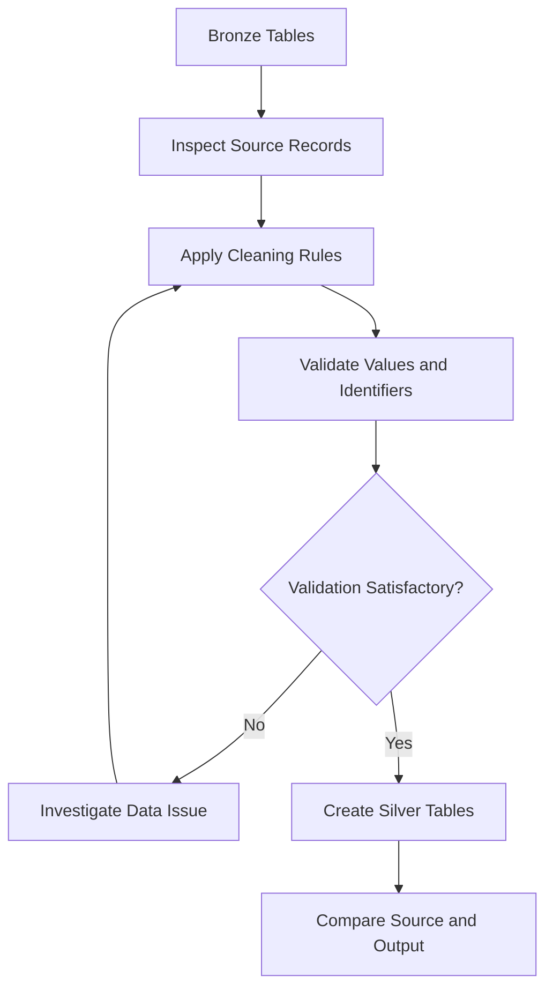
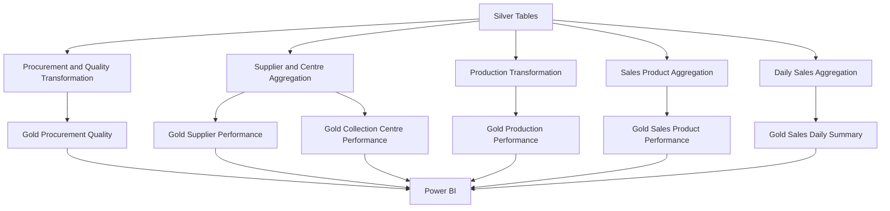

# Bronze, Silver and Gold Layers


## Purpose
This file answers what Bronze, Silver and Gold mean in DairyChain, which tables sit in each layer, and what each layer is for. It is for a reader who needs the Medallion Architecture without overclaiming it.

## In this file
- Medallion architecture
- Bronze
- Silver
- Gold
- Design considerations
- What this is and is not

## Medallion architecture
DairyChain uses the Medallion Architecture: Bronze, then Silver, then Gold. Each layer is one PostgreSQL schema in the `dairychain` database, and data is refined one layer at a time.

| Layer | Schema | Purpose | Tables | Columns | Rows |
|---|---|---|---|---:|---:|
| Bronze | `bronze` | Raw ingestion as-is: source CSV data loaded into PostgreSQL without cleaning | 10 | 82 | 99,584 |
| Silver | `silver` | Cleaned and typed: the same records with proper data types and cleaning applied | 10 | 83 | 99,584 |
| Gold | `gold` | Business-ready aggregates: analytical tables built for reporting in Power BI | 6 | 73 | 22,596 |

Bronze and Silver hold the same 10 table names: `collection_centres`, `milk_procurement`, `production_batches`, `production_inputs`, `production_outputs`, `products`, `quality_tests`, `sales_order_lines`, `sales_orders`, `suppliers`. Gold holds 6 tables: `procurement_quality_summary` (18,000), `collection_centre_performance` (20), `supplier_performance` (200), `production_performance` (4,000), `sales_product_performance` (12), `sales_daily_summary` (364). Source: schemas and table names from Source 17 (psql schema query and table inventory, 26 rows), column names and types from Source 18 (238 columns), Gold row counts from Source 19 (live database COUNT(*), total 22,596), Bronze and Silver row totals from Source 25 (99,584 each). Silver kept all 99,584 rows, so cleaning dropped 0 rows at the Bronze-to-Silver step. The flow is CSV to Bronze to Silver to Gold to Power BI, ELT-style: load to Bronze first, then transform in SQL (Source 9, documented intent).

## Bronze
Bronze stores the ingested source data in PostgreSQL. It is the initial storage layer for downstream processing. Source: 10 CSV files, 99,584 total records. The Bronze schema maintains the ingested source tables and provides the starting point for database-level cleaning and transformations.

### Objective
Maintain the records ingested from the source files in PostgreSQL. Schema: `bronze`.

### Recorded characteristics
| Metric | Value |
|---|---:|
| Source CSV files | 10 |
| Bronze tables | 10 |
| Bronze columns | 82, all `text` (Source 18) |
| Total recorded rows | 99,584 (Source 25) |

### Responsibilities
The Bronze layer provides a database-level starting point for downstream transformations. It allows the pipeline to separate ingestion from subsequent data cleaning and analytical processing. At this stage, important questions include: were the intended source records loaded, do the database tables contain the expected columns, are identifiers and values preserved appropriately, and are any ingestion failures or unexpected row-count differences present?

### Bronze validation
A basic table row-count check can be performed using SQL:

```sql
SELECT COUNT(*) AS total_rows
FROM bronze.procurement;
```

The table name above is illustrative. Use the actual Bronze table name from the project implementation. For a complete check, run an equivalent row-count query for each Bronze table and compare it with the corresponding source file.

### Important distinction
The Bronze layer should not automatically be described as an immutable raw-data archive unless the actual ingestion process preserves records without modification and provides the required retention controls. Its precise behaviour must be documented from the Python code and database implementation.

## Silver
Silver contains 10 cleaned and structured tables. It provides prepared data for analytical transformations. This layer represents the cleaned and transformed data used for further processing.

### Objective
Prepare cleaned and structured tables from the Bronze data. Schema: `silver`.

### Recorded characteristics
| Metric | Value |
|---|---:|
| Silver tables | 10 |
| Silver columns | 83, typed (Source 18) |
| Total recorded rows | 99,584 (Source 25) |
| Rows dropped from Bronze | 0 (99,584 in, 99,584 out) |

### Why a Silver layer is important
Source data is not always ready for analysis. It may contain: missing values, inconsistent data types, duplicate records, inconsistent date formats, incorrect or invalid values, inconsistent identifiers, and records requiring business-rule validation. The Silver layer provides a dedicated stage for preparing data before analytical aggregation.

### Typical transformation activities
The exact cleaning rules should be taken from the actual SQL scripts. The following are potential activities to check, not a claim that all were implemented:

| Transformation | Objective |
|---|---|
| Data-type conversion | Use appropriate database data types |
| Missing-value handling | Apply defined rules to incomplete records |
| Duplicate handling | Identify and address duplicate records |
| Date standardisation | Make date fields consistent |
| Identifier checks | Maintain entity consistency |
| Business-rule validation | Identify invalid business values |
| Column organisation | Prepare structured tables for downstream processing |

### Conceptual transformation flow


### Silver validation
Validation should include: column structure, data types, missing-value counts, duplicate identifiers where uniqueness is expected, date validity, numeric range checks, business-rule checks, and row-count comparison with Bronze.

### Row-count interpretation
A difference between Bronze and Silver row counts does not automatically indicate a problem. For example, a transformation may intentionally remove invalid records or retain only records satisfying a defined rule. Every meaningful difference should be explained by the transformation logic.

## Gold
Gold contains 6 analytical tables designed to support reporting and business analysis. The table names, grains and record counts are in [../02_System_Architecture/data_dictionary.md](../02_System_Architecture/data_dictionary.md). Gold tables do not all have the same level of detail: some represent individual business records, while others contain aggregated performance metrics.

### Objective
Prepare business-level analytical tables for reporting and analysis. Schema: `gold`.

### Recorded characteristics
| Gold table | Recorded rows | Grain |
|---|---:|---|
| procurement_quality_summary | 18,000 | One row per procurement batch | Row count from Source 19 (live database COUNT(*), 2026-11-11). |
| collection_centre_performance | 20 | One row per collection centre |
| supplier_performance | 200 | One row per supplier |
| production_performance | 4,000 | One row per production batch |
| sales_product_performance | 12 | One row per product |
| sales_daily_summary | 364 | One row per date |

### Why Gold exists
The Gold layer prepares structured business data so that reporting does not need to repeatedly perform all transformations from the original source tables. It supports: procurement and quality analysis, supplier comparisons, collection-centre performance, production analysis, product performance, and daily sales reporting.

### Gold transformation flow


### Gold table responsibilities
1. Procurement quality summary: procurement batch-level information, including milk quantity, purchase cost, supplier, collection centre, quality measurements, quality status, and rejection reason.
2. Collection centre performance: collection-centre-level procurement, accepted and rejected volumes, rejection percentage, and average quality measurements.
3. Supplier performance: supplier-level procurement volumes, acceptance, rejection, and quality measurements.
4. Production performance: production-batch information, including raw milk input, finished product output, byproduct output, and duration.
5. Sales product performance: product-level orders, quantities, discounts, revenue, and average selling price.
6. Sales daily summary: daily order, fulfilment, quantity, discount, and revenue metrics.

### Important: table grain
Gold tables have different aggregation levels. For example: a procurement table contains batch-level details, a supplier table contains supplier-level summaries, a product table contains product-level summaries, and a daily sales table contains date-level summaries. These tables should not be joined or aggregated without considering their grain. Incorrect joins can duplicate records and inflate business metrics.

## Structure and transformation logic
The Medallion layers exist and their contents are shown as stated in the table above: layer names and schemas (Source 17), table names per layer (Source 17), column names and types per layer (Source 18), and row counts per layer (Source 19 for Gold, Source 25 given by the user for Bronze and Silver).

The cleaning activities listed under Silver above and the transformation flows shown under Gold above are documented intent from Source 9. The Colab notebook (Source 15) shows pandas validation and transformation logic in Colab.

## Design considerations

### Layer separation
Bronze, Silver, and Gold separate the different stages of data processing. This makes it easier to understand where data originates and how it is prepared for analysis.

### Table grain
Each Gold table has a different grain. Queries and measures must respect that grain to avoid duplicate counting or incorrect aggregation.

### Unit consistency
Production output may be measured in different units. Litres and kilograms must not be treated as interchangeable quantities. Production batches split as 3,001 litre-based batches and 999 kg-based batches, total 4,000. Keep them separate in every sum, average and chart.

### Reconciliation
Important Gold metrics should be checked against their underlying records. Power BI measures should also be compared with the corresponding database calculations.

### Database credentials
Credentials should not be exposed in the source code or public repository. Configuration and secret-handling practices are documented separately in [../10_Security_and_Reliability/credential_management.md](../10_Security_and_Reliability/credential_management.md).

### Failure handling
Failures during file reading, database connection, or transformation should be visible and investigated. The available project evidence does not establish a separate automated monitoring or orchestration service.

## What this is and is not
This is a three-layer design as described in the README, the System Architecture document, and the Data Ingestion and Transformation Pipeline document (Source 9). The layer counts are shown as README statements.

## Next step / Related files
- [Data ingestion](data_ingestion.md)
- [Pipeline execution](pipeline_execution.md)
- [Database design](../02_System_Architecture/database_design.md)
