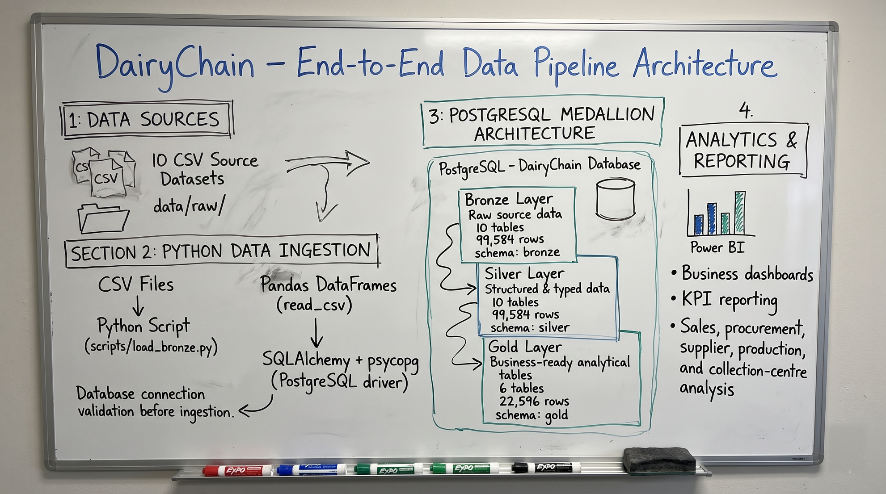
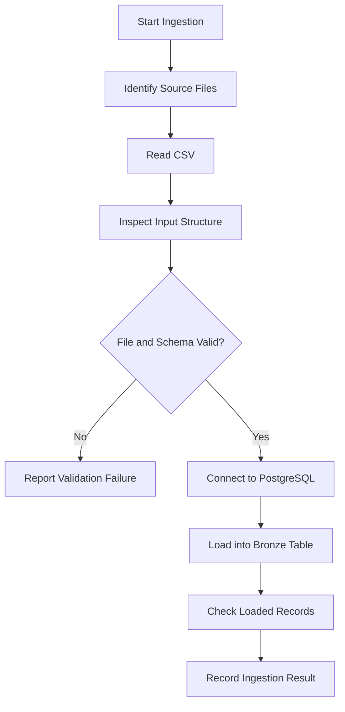

# Data Ingestion


## Purpose
This file answers how source data enters DairyChain and what must be recorded at the point of entry. It is for a developer who needs to run ingestion and prove what arrived.

## In this file
- Purpose and pipeline place
- Medallion flow
- ETL versus ELT
- Source data
- Stage 1 - Python ingestion
- Ingestion validation
- Notes

## Purpose and pipeline place
The pipeline converts source CSV files into structured analytical tables for business reporting. The documented workflow is: CSV Source Files, then Python Ingestion, then PostgreSQL Bronze, then SQL Silver, then SQL Gold, then Power BI. Ingestion is the first step. Its job is to load source data into PostgreSQL, organise it into Bronze, and make it available for cleaning, transformation, and reporting. Validation matters at this stage, because a later Gold number can only be trusted if the load that produced it was checked.

## Medallion flow
DairyChain uses the Medallion Architecture: Bronze, then Silver, then Gold. Ingestion is the first step of that flow: CSV files to Bronze.

Flow: Source CSV Files -> Python Ingestion -> PostgreSQL Medallion Architecture (Bronze -> Silver -> Gold) -> Power BI. Bronze, Silver, and Gold are three schemas inside ONE PostgreSQL database, `dairychain`, not three separate databases.



The image above is the user-supplied architecture whiteboard (Source 27, 2026-11-11). It is an illustration of the intended pipeline. The whiteboard picture names load_bronze.py, SQLAlchemy + psycopg, read_csv, and connection validation. The build described here uses the Colab notebook and the CSV files.

| Layer | Schema | Tables | Rows | What happens |
|---|---|---|---|---:|
| Bronze | `bronze` | 10 | 99,584 | Raw ingestion as-is: source CSV data loaded into PostgreSQL without cleaning, every column `text` |
| Silver | `silver` | 10 | 99,584 | Cleaned and typed: the same records with proper data types and cleaning applied, 0 rows dropped |
| Gold | `gold` | 6 | 22,596 | Business-ready aggregates: analytical tables built for reporting in Power BI |

The layer inventory is shown: schemas and table names by Source 17, column names and types by Source 18 (Bronze 82 columns, all `text`; Silver 83, typed; Gold 73, typed), Gold row counts by Source 19, Bronze and Silver row totals from Source 25. The notebook (Source 15) shows pandas validation and transformation logic, but it has no SQL and no Bronze load, so it must not be read as the database transformation.

## ETL versus ELT
ETL stands for Extract, Transform, Load. In a traditional ETL process, data is transformed before being loaded into the target database. ELT stands for Extract, Load, Transform. In an ELT process, data is first loaded into the database, and transformations are then performed inside the database. DairyChain follows the ELT pattern. Source files are loaded into PostgreSQL Bronze before the subsequent transformations are done in SQL. Python handles source ingestion, while PostgreSQL and SQL are used for downstream data preparation. This distinction explains the responsibilities of the technologies used in the project.

## Source data
The pipeline begins with 10 CSV source files, 99,584 total records. These files provide the information required for the project's main business areas: procurement, milk quality, collection centres, suppliers, production, sales, and order fulfilment. The source files were first known from the notebook (Source 15). They are now supplied as files (Source 28, user-supplied `DairyChain_dataset_full.zip`, 2026-11-11): the 10 CSVs are in `data/raw/` flat, with the data dictionary, validation report, and checksums in `data/`. They are listed in full in [data_dictionary.md](../02_System_Architecture/data_dictionary.md) under "Source CSV files - Source 28": 10 files, 99,584 rows in total. Each file was SHA256-checked against the supplied `SHA256SUMS.txt` (all 10 OK) and recounted with `wc -l`, matching the README exactly.

The dataset is synthetic, made for this project, covering 2025-11-01 to 2026-10-31. It is not real operational dairy data. The modelling assumptions (650 L of accepted raw milk per completed batch in FIFO order, simplified direct raw-milk conversion with illustrative yield factors, the second output as a combined coproduct/residual amount, chronological order processing capped by finished goods available) are in the zip README, copied to [dataset_README.md](../13_Project_Evidence/dataset_README.md).

The 5 intentional data-quality scenarios in the data are now supplied with their source, not only found by the notebook. DQ-01 (SUP-0015 lowercase status), DQ-02 (SUP-0042 whitespace in village), DQ-03 (PRC-000500 non-ISO timestamp), DQ-04 (PRC-001000 cost inflated by 25 percent), DQ-05 (QCT-000250 NULL temperature) are documented in the zip data dictionary. DQ-03, DQ-04, and DQ-05 match the notebook findings in Source 15 (the PRC-000500 timestamp fix, the PRC-001000 cost mismatch of 6,657.17, and the 1 missing temperature QCT-000250).

Before ingestion, the input files should be understood in terms of: file names and locations, expected columns, data types, unique identifiers, date and timestamp fields, numeric and measurement fields, and relationships between business entities. Understanding the source structure is important because the later database transformations depend on the accuracy and consistency of the input.

## Stage 1 - Python ingestion

### Objective
Read the source CSV files and load their records into PostgreSQL Bronze tables. That is the documented intent. The notebook itself does not do the load: it reads the CSVs into Pandas, profiles them and validates them, and never writes to PostgreSQL. See "What the notebook actually does - Source 15" below.

### Why Python?
Python is used for file handling, data reading, and database interaction. It provides a programmable way to process multiple input files and connect the ingestion process to PostgreSQL. In the notebook supplied, Python is used for reading, profiling and validating only. No database library is imported and no database connection is opened.

### Ingestion workflow


The diagram describes the intended logical sequence. Against the notebook (Source 15), steps A to F are what the notebook actually does.

### Responsibilities
The ingestion stage should: locate the intended source files, read the input data, identify missing files or unexpected structures, connect to the PostgreSQL database, load records into the appropriate Bronze tables, make ingestion failures visible, and provide a way to check whether the load was successful.

### Representative Python example
The following example illustrates basic CSV inspection before database loading.

```python
from pathlib import Path
import pandas as pd

file_path = Path("data/raw/procurement.csv")

if not file_path.exists():
    raise FileNotFoundError(
        f"Input file not found: {file_path}"
    )

df = pd.read_csv(file_path)

print("Input dimensions:", df.shape)
print("Columns:", df.columns.tolist())

print("\nMissing values:")
print(df.isnull().sum())

print("\nDuplicate rows:")
print(df.duplicated().sum())

print("\nData types:")
print(df.dtypes)
```

## Ingestion validation
| Check | Purpose |
|---|---|
| File existence | Confirm the intended input is available |
| Row count | Identify the number of records read |
| Column count | Confirm the file structure |
| Column names | Identify schema mismatches |
| Data types | Identify incompatible values |
| Missing values | Identify incomplete records |
| Duplicate records | Identify potential duplication |

For each file, record: file name, rows read, rows loaded, rows rejected, and the reason for any rejection. Without that log, a missing file looks the same as an empty file.

### Recorded project reference
The Bronze layer contains 10 tables representing 99,584 rows in total. This is the recorded project inventory. It should be independently checked against the current database when reproducing the project.

## What the notebook actually does - Source 15
Notebook `dairychain.ipynb`, user-supplied 2026-11-11, inspected from the file itself. 148 code cells, 0 markdown cells, 157 stored outputs. Imports only: `pandas`, `os`, `zipfile`, `google.colab.files`, `matplotlib.pyplot`. No `psycopg`, no `sqlalchemy`, no `to_sql`, no `create_engine`, no SQL text, no credentials.

- Upload: cell 4 uploads `DairyChain_dataset_full.zip` with `google.colab.files.upload`. Cell 6 unzips it to `/content/dairychain`.
- File list: cell 11 lists `data/raw/` as `sales/` (sales_orders.csv, sales_order_lines.csv), `procurement/` (milk_procurement.csv, quality_tests.csv), `production/` (production_inputs.csv, production_outputs.csv, production_batches.csv), `master/` (collection_centres.csv, suppliers.csv, products.csv).
- Reads: 10 files are loaded with `pd.read_csv` from base path `/content/dairychain/DairyChain_dataset/data/raw`, one per file, into `suppliers_df`, `procurement_df`, `quality_test_df`, `collection_centers_df`, `products_df`, `production_batches_df`, `production_outputs_df`, `production_inputs_df`, `sales_orders_df`, `sales_order_lines_df`. An 11th read (cell 63) tried `collection_centers.csv` and failed; cell 65 corrected it to `collection_centres.csv`. See BUG-002 in [troubleshooting_log.md](../08_Debugging_and_Troubleshooting/troubleshooting_log.md).
- Shapes from stored outputs: suppliers 200 rows by 9 columns, milk procurement 18,000 by 10, quality tests 18,000 by 10, collection centres 20 by 9, products 12 by 8, production batches 4,000 by 7, production outputs 8,000 by 7, production inputs 9,352 by 7, sales orders 14,000 by 7, sales order lines 28,000 by 8. Total 99,584 rows, which matches the README total. The notebook's own summary table (cell 80) shows the same row counts, with column counts after derived columns were added: milk procurement 14, production batches 8, sales orders 8, sales order lines 9.
- Profiling per file: `shape`, `columns`, `info`, `isnull.sum`, `duplicated.sum`, duplicate key checks, `value_counts` and `describe`.
- Transformations in the notebook: procurement timestamp cleaning (cells 30-32, one non-ISO value `10/11/2025 19:19` for PRC-000500, parsed to 2025-11-10 19:19:00 with `format='mixed'`, `dayfirst=True`, `errors='coerce'`); `calculated_cost = quantity_litres * purchase_rate_per_litre` (cell 36), `cost_difference = total_purchase_cost - calculated_cost` (cell 37), `cost_status` valid or COST_MISMATCH (cells 39-40); rejection rules SNF below 8.2, fat below 3.2, acidity above 0.17, temperature above 8.5C (cell 61); temperature and rejection-reason status flags (cell 82); supplier, centre and product summaries by `groupby` (cells 98-105, 124-137); production input/output checks by unit (cells 87-96); sales fulfilment checks at line level and order level (cells 84-86); 8 matplotlib charts (cells 138-145). The chart values are images, not text, so no chart value is quoted here.
- The notebook uses pandas, os, zipfile, google.colab, and matplotlib only. The only PostgreSQL mention is cell 146, a PowerShell `psql.exe` command pasted as a Python cell, which produced a SyntaxError. See BUG-004. The notebook prints no package versions; the only version hint is the Python 3.13 path in a traceback. Do not invent a pandas or Python version.

## Notebook inspection checklist - Source 14, answered by Source 15
Code cells: 148, all code. Imports: pandas, os, zipfile, google.colab.files, matplotlib.pyplot. PostgreSQL connection: none in code. Ingestion operations: zip upload, unzip, 10 CSV reads, profiling. Transformations: listed above. Execution outputs: 157 stored outputs, including 4 errors (BUG-001 to BUG-004). All `execution_count` values are None, so no clean top-to-bottom run order can be claimed from them; the stored outputs are evidence of what ran at some point, not proof of one clean run.

## Notes
The CSV reading, profiling and validation part comes from the notebook's stored outputs (Source 15). The row counts come from the notebook as well as from the README, and the two agree at 99,584 rows. Source: Data Ingestion and Transformation Pipeline document, user-supplied 2026-11-11, Source 9. Clarification: Source 14, 2026-11-11. Notebook: Source 15, 2026-11-11.

## Next step / Related files
- [Data validation](data_validation.md)
- [Bronze Silver Gold](bronze_silver_gold_layers.md)
- [Pipeline execution](pipeline_execution.md)
