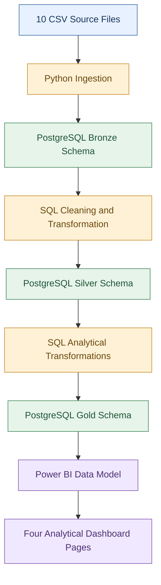

# Pipeline Execution

> Status: PENDING EVIDENCE

## Purpose
This file answers how the DairyChain pipeline is run, in what order, and what evidence a run should leave behind. It is for a developer who needs to reproduce a run and prove it happened.

## In this file
- End-to-end pipeline architecture
- Run order
- Flow responsibilities
- Pipeline reliability considerations
- Reproducibility
- Evidence a run should leave
- Scope limits
- Status

## End-to-end pipeline architecture

### Pipeline summary
| Stage | Technology | Responsibility |
|---|---|---|
| Extract | CSV files and Python | Read the source files |
| Load | Python and PostgreSQL | Load source records into Bronze |
| Transform 1 | SQL | Clean and structure data in Silver |
| Transform 2 | SQL | Prepare analytical tables in Gold |
| Report | Power BI | Analyse and visualise the resulting data |

## Run order
1. Ingest the 10 CSV files into Bronze.
2. Validate Bronze counts against the source files.
3. Clean and structure the data into Silver.
4. Validate Silver, including duplicates, missing values and units.
5. Build the 6 Gold tables.
6. Validate Gold counts and sums against Silver.
7. Refresh the Power BI report from Gold.

## Flow responsibilities
| Stage | Input | Output |
|---|---|---|
| Python ingestion | CSV files | Loaded PostgreSQL Bronze tables |
| Bronze processing | Ingested records | Source tables available for transformation |
| Silver transformation | Bronze tables | Cleaned Silver tables |
| Gold transformation | Silver tables | Analytical Gold tables |
| Power BI | Gold tables | Dashboard visuals and business metrics |

This is the documented logical flow. It does not imply that a scheduler, cloud service, or orchestration platform runs the pipeline automatically.

## Pipeline reliability considerations
A data pipeline should also be reviewed for operational reliability. The following are recommended considerations. Their implementation status must be confirmed separately.

- Failure handling: what happens when a source file is missing, a database connection fails, or a transformation fails?
- Repeatability: can the same ingestion or transformation operation be run again without producing incorrect duplicate records?
- Transaction safety: are database operations committed or rolled back appropriately when a load fails?
- Logging: can a developer identify which file or processing stage failed?
- Data validation: are row counts and key business metrics checked after processing?
- Configuration: are connection settings separated from the source code?
- Dependency management: are Python packages identified from the Colab notebooks where verifiable, and installable in the intended environment? Do not invent package versions.
- Operational limitation: the documented project architecture does not establish automated scheduling, incremental loading, workflow orchestration, or production monitoring. These capabilities should be identified as future improvements unless the actual implementation proves otherwise.

## Reproducibility
To reproduce the documented data pipeline, a developer should have access to: the project ZIP including the Google Colab notebooks (.ipynb), the required input files, a working PostgreSQL environment, the required database schemas and SQL transformation scripts, and the Power BI report and its configuration. Identify the actual Python packages and versions from the notebooks where verifiable only, and do not invent versions or create an assumed requirements.txt. The exact execution commands and database configuration should be maintained in `REPRODUCIBILITY.md`. Passwords and other secrets must be provided securely and must not be committed to Git.

## Evidence a run should leave
- A log with start and end time, files read, rows loaded, rows rejected and errors.
- Row counts at Bronze, Silver and Gold for the same run.
- The SQL used to build Gold, with the run date.
- A note of any manual fix applied during the run.

## Scope limits
The following capabilities should not be claimed without additional implementation evidence. Status: NOT IMPLEMENTED.

- Cloud deployment.
- Scheduled pipeline execution.
- Apache Airflow orchestration.
- Incremental data loading.
- Real-time data ingestion.
- Automated database backups.
- Production monitoring and alerting.
- CI/CD deployment.
- Automated schema migration.

These are potential future improvements, not established components of the current architecture.

## What the notebook proves about a run - Source 15
One Colab notebook, `dairychain.ipynb`, was supplied 2026-11-11 and inspected. It proves the CSV reading, profiling and validation stage ran at some point: 10 files read, 99,584 rows, stored outputs for the checks. It does not prove a pipeline run: there is no Bronze load, no Silver or Gold build, no run log, no start or end time, and no run date in it. All `execution_count` values are None, so no single clean run order can be claimed. The run-order list above stays as documented intent, not as an observed run.

## Status
PENDING EVIDENCE for a pipeline run. The notebook stage (CSV read and validation) is Verified execution results from stored outputs. No run log, Bronze load, Silver build or Gold build was supplied yet. Do not claim the pipeline ran successfully, and do not claim a run time or a run date. When a run log is supplied, add it here with its date and its counts. Source: Data Ingestion and Transformation Pipeline document, user-supplied 2026-11-11, Source 9. Clarification: Source 14, 2026-11-11 - Python implementation is in Google Colab notebooks, not separate local scripts. Notebook: Source 15, 2026-11-11.

## Next step / Related files
- [Data ingestion](data_ingestion.md)
- [Data validation](data_validation.md)
- [Implementation status](../13_Project_Evidence/implementation_status.md)
