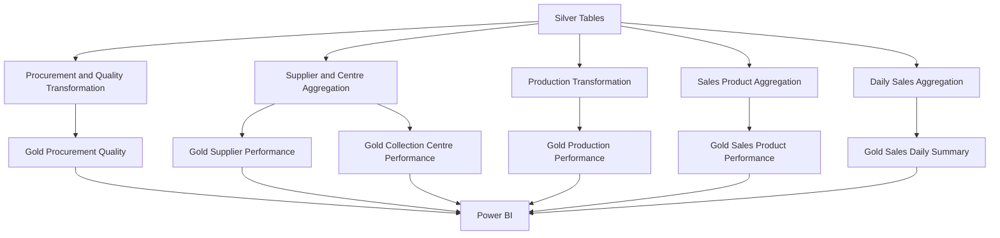

# Transformation Logic

## Purpose
This file answers how Silver data becomes Gold data and what grain each Gold table uses. It is for a reader who needs to check a Gold sum or rebuild a Gold table.

## In this file
- From Silver to Gold
- Silver transformation activities
- Gold transformation flow
- Grain and aggregation
- Unit rules

## From Silver to Gold
Silver holds cleaned operational records. Gold holds analytical summaries built from Silver. Each Gold table answers one reporting question at one grain, so a reader does not have to re-aggregate raw batches for every report.

## Silver transformation activities
The exact cleaning rules should be taken from the actual SQL scripts. The following are potential activities to check, not a claim that all were implemented:

| Transformation | Objective |
|---|---|
| Data-type conversion | Use appropriate database data types |
| Missing-value handling | Apply defined rules to incomplete records |
| Duplicate handling | Identify and address duplicate records |
| Date standardisation | Make date fields consistent |
| Identifier checks | Maintain entity consistency |
| Business-rule validation | Identify invalid business values |
| Column organisation | Prepare structured tables for downstream processing |

## Gold transformation flow

## Grain and aggregation
| Gold table | Grain | Records |
|---|---:|---:|
| procurement_quality_summary | Procurement batch | 18,000 |
| collection_centre_performance | Collection centre | 20 |
| supplier_performance | Supplier | 200 |
| production_performance | Production batch | 4,000 |
| sales_product_performance | Product | 12 |
| sales_daily_summary | Day | 364 |

Gold tables have different aggregation levels. For example: a procurement table contains batch-level details, a supplier table contains supplier-level summaries, a product table contains product-level summaries, and a daily sales table contains date-level summaries. These tables should not be joined or aggregated without considering their grain. Incorrect joins can duplicate records and inflate business metrics.

## Unit rules
- Milk volume is in litres. Production output is in litres for litre-based batches and in kg for kg-based batches. Keep them separate in every sum, average and chart. Production batches split as 3,001 litre-based batches and 999 kg-based batches, total 4,000.
- Sales quantity fulfilled is 161,036.41 against quantity ordered 181,804. The unit for sales quantity was not stated in the README, so do not add a unit label to it until the schema confirms it.

## Next step / Related files
- [Bronze Silver Gold](bronze_silver_gold_layers.md)
- [KPI definitions](../04_Business_Analytics/kpi_definitions.md)
- [Query references](../13_Project_Evidence/query_references.md)
