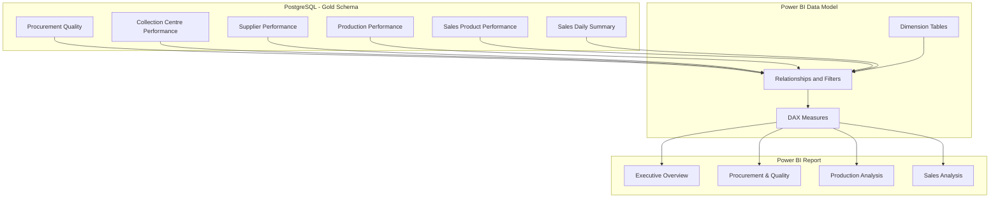
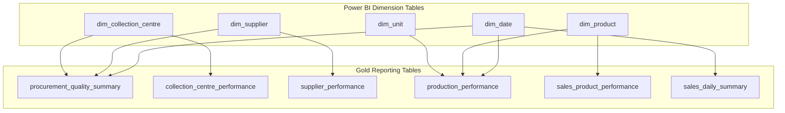

# Analytics Methodology

## Purpose
This file answers how DairyChain turns a business question into a SQL answer, step by step. It is for an analyst who needs to repeat the method on a new question without changing the rules.

## In this file
- The method, step by step
- Tools used
- Power BI reporting architecture
- Power BI data model (Source 10)
- Power BI data model (Source 11)
- Power BI model - from Source 23 (pbixray): DAX, relationships, dims, model data
- Rules that apply to every analysis
- SQL development principles, result interpretation, and analytical limitations (Source 13)

## The method, step by step
1. State the business question in one sentence.
2. State why it matters to the dairy business.
3. Name the Gold table and the grain needed to answer it.
4. Define each KPI with a formula before calculating it.
5. Write the SQL with joins at the correct grain, so no value is counted twice.
6. Run the query, keep the output, and check the totals against a second method.
7. Write the direct answer, the interpretation, and the recommendation.

## Tools used
SQL is used for relational analysis: aggregations with GROUP BY, multi-table joins, CTEs, conditional aggregation and date-based analysis. Python and Pandas are used for ingestion and transformation. Power BI and DAX are used for reporting. The illustrative SQL and Python examples from the brief are in [../07_AI_Assisted_Development/sql_development.md](../07_AI_Assisted_Development/sql_development.md) and [../07_AI_Assisted_Development/python_development.md](../07_AI_Assisted_Development/python_development.md).

## Power BI reporting architecture
Power BI acts as the reporting and visualisation layer. The Gold tables provide the business-level data used by the dashboard. The reporting model also uses dimensions to support filtering and analysis.

The documented dimension tables include:

- `dim_date`
- `dim_product`
- `dim_supplier`
- `dim_collection_centre`
- `dim_unit`

These dimensions are documented in the user-supplied System Architecture document (Source 8, 2026-11-11). Their table names are now from Source 22: all 5 appear in the DiagramLayout of the supplied `dairy_chain_project.pbix`, with the 6 Gold tables, 11 model tables in total. Their columns and DAX definitions are now from Source 23 (pbixray): the dims are DAX calculated tables derived from the Gold tables, and their exact formulas are in [kpi_definitions.md](kpi_definitions.md). Their relationships are also now shown: only one relationship exists in the model, and none of the 10 intended dimension relationships exists - see the Source 23 check block below.

The intended reporting structure is:

### Dashboard pages
| Page | Purpose |
|---|---|
| Executive Overview | Display key business metrics across the project |
| Procurement & Quality Analysis | Analyse procurement volumes, quality, and rejection |
| Production Performance Analysis | Analyse raw milk input, finished output, and production batches |
| Sales Analysis | Analyse revenue, products, orders, and fulfilment |

The detailed visual layouts and DAX calculations are documented separately in the Power BI documentation. DAX measures in this set are now from Source 23 (pbixray): 23 DAX measures, 21 with formulas, 2 empty placeholders, plus shown calculated columns and calculated tables. The shown formulas are in [kpi_definitions.md](kpi_definitions.md). KPI values are also now from the model data read with pbixray get_table - see the Source 23 section in [kpi_definitions.md](kpi_definitions.md) and the evidence file [pbixray_model_data_totals.txt](../13_Project_Evidence/pbixray_model_data_totals.txt).

## Power BI data model (Source 10)
Source: the user-supplied "DairyChain - Database Architecture" document (Source 10, 2026-11-11, section 12). Power BI uses the Gold tables and additional dimensions to organise reporting and filtering. The dimensions were part of the Power BI data-modelling work. They should not automatically be described as PostgreSQL tables, because their documented use is in the Power BI model. Their table names are now from Source 22 (all 5 appear in the DiagramLayout of the supplied.pbix, with the 6 Gold tables). Their columns and DAX definitions are now from Source 23 (pbixray), and their relationships are now shown as mostly missing - see the Source 23 block after the mapping table below.

### Dimensions
| Dimension | Main purpose |
|---|---|
| `dim_date` | Date-based filtering and analysis |
| `dim_product` | Product-based filtering |
| `dim_supplier` | Supplier-based filtering |
| `dim_collection_centre` | Collection-centre filtering |
| `dim_unit` | Production unit filtering |

### Intended relationship mapping
| Dimension | Reporting table | Join columns |
|---|---|---|
| `dim_date` | `sales_daily_summary` | Date to order_date |
| `dim_date` | `procurement_quality_summary` | Date to procurement_date |
| `dim_date` | `production_performance` | Date to production_date |
| `dim_product` | `sales_product_performance` | product_id |
| `dim_product` | `production_performance` | product_id |
| `dim_supplier` | `supplier_performance` | supplier_id |
| `dim_supplier` | `procurement_quality_summary` | supplier_id |
| `dim_collection_centre` | `collection_centre_performance` | collection_centre_id |
| `dim_collection_centre` | `procurement_quality_summary` | collection_centre_id |
| `dim_unit` | `production_performance` | Unit to unit_of_measure |

### Source 23 - relationships in the model: 1 exists
Pbixray `relationships` returns exactly one row: `gold procurement_quality_summary[supplier_id]` to `gold supplier_performance[supplier_id]`, IsActive 1, Cardinality M:1, CrossFilteringBehavior Single, FromKeyCount 203, RelyOnReferentialIntegrity 0. This is a MAJOR correction: none of the 10 intended dimension relationships in the table above exists in the model. DISCREPANCY (Source 24b, 2026-11-11): a Model view screenshot supplied by the user shows relationship LINES between many of the same tables (about ten lines visible, with 1 and * markers), including lines from the dimensions to the Gold tables. That disagrees with the 1 relationship found in the uploaded file. Either the user added relationships in Power BI Desktop after uploading the.pbix here, or the screenshot is from a newer saved version of the file than the one uploaded - neither is confirmed, so neither is claimed. The Source 23 finding is NOT overwritten. The exact join columns cannot be read from the screenshot, so no column-level join is claimed. The user is asked to re-upload the.pbix if he saved the model with those relationships, so the file and the screenshot match. The single relationship that does exist is a fact-to-fact link between the two Gold tables on `supplier_id`; it is not one of the documented dimension relationships, and it is not via `dim_supplier`. The 10 intended relationships that are missing are: `dim_date` to `sales_daily_summary`, `dim_date` to `procurement_quality_summary`, `dim_date` to `production_performance`, `dim_product` to `sales_product_performance`, `dim_product` to `production_performance`, `dim_supplier` to `supplier_performance`, `dim_supplier` to `procurement_quality_summary`, `dim_collection_centre` to `collection_centre_performance`, `dim_collection_centre` to `procurement_quality_summary`, and `dim_unit` to `production_performance`. Consequence: most slicers do not propagate through the model as documented, because there is no relationship for them to follow. Do not invent the missing relationships.

### Known mismatch: dim_date mapping columns - EXPLAINED AS DERIVED DATE FIELDS
Two join columns in the mapping above do not appear in the Gold column lists in Source 10, sections 5 and 8:

- `procurement_date` is used for `dim_date` to `procurement_quality_summary`, but the documented procurement column is `procurement_timestamp`, not `procurement_date`.
- `production_date` is used for `dim_date` to `production_performance`, but the documented production columns are `production_start` and `production_end`, not `production_date`.

Source 11, section 4.1, explains this: `procurement_date` and `production_date` are date-level fields derived from the relevant timestamps. The exact formulas are DAX calculated columns in the model: `procurement_date` on `gold procurement_quality_summary` = DATE(YEAR(procurement_timestamp), MONTH(procurement_timestamp), DAY(procurement_timestamp)), and `production_date` on `gold production_performance` = DATE(YEAR(production_start), MONTH(production_start), DAY(production_start)). They are NOT columns in PostgreSQL - the Source 18 column dump (238 rows) has no `procurement_date` or `production_date` in any Gold table. This note is kept here, in [../02_System_Architecture/data_dictionary.md](../02_System_Architecture/data_dictionary.md), and in the check record, as a resolved mismatch.

## Power BI data model (Source 11)
Source: the user-supplied "DairyChain - Power BI Data Model" document (Source 11, 2026-11-11, 14 sections). The model connects the Gold tables with dimension tables to support filtering, aggregation, and business analysis across procurement, quality, production, and sales. Its objectives are to organise reporting data into a clear model, connect relevant tables through common identifiers, avoid unnecessary fact-to-fact relationships, maintain correct filter behaviour, prevent duplicate counting and incorrect aggregations, and ensure that dashboard measures represent the intended business definitions. The model must be understood not only in terms of which tables are connected, but also what one row in each table represents. Relationship cardinality, active status, and filter direction are now from Source 23 (pbixray): only one relationship exists in the model, `gold procurement_quality_summary[supplier_id]` to `gold supplier_performance[supplier_id]`, IsActive 1, Cardinality M:1, CrossFilteringBehavior Single. None of the 10 intended dimension relationships exists. See the Source 23 block in the Source 10 section above.

### Model overview
Power BI uses six Gold tables and five documented dimension tables.

Gold tables:

1. `gold procurement_quality_summary`
2. `gold collection_centre_performance`
3. `gold supplier_performance`
4. `gold production_performance`
5. `gold sales_product_performance`
6. `gold sales_daily_summary`

Dimension tables:

1. `dim_date`
2. `dim_product`
3. `dim_supplier`
4. `dim_collection_centre`
5. `dim_unit`

Shown dimension definitions (Source 23, pbixray): the five dimensions are DAX calculated tables derived from the Gold tables, not tables loaded from PostgreSQL. `dim_date` = CALENDAR(MIN('gold sales_daily_summary'[order_date]), MAX('gold sales_daily_summary'[order_date])); `dim_product` = DISTINCT(SELECTCOLUMNS('gold sales_product_performance', product_id, product_name, category)); `dim_supplier` = DISTINCT(SELECTCOLUMNS('gold supplier_performance', supplier_id, supplier_name, supplier_district)); `dim_collection_centre` = DISTINCT(SELECTCOLUMNS('gold collection_centre_performance', collection_centre_id, centre_name, centre_district)); `dim_unit` = DISTINCT(SELECTCOLUMNS('gold production_performance', "Unit", TRIM('gold production_performance'[unit_of_measure]))). Full formulas are in [kpi_definitions.md](kpi_definitions.md).

The dimension tables provide common attributes used to filter relevant reporting tables.

### Conceptual data model

This diagram represents the intended logical reporting model. It is NOT the actual model: Source 23 (pbixray) shown that only one relationship exists in the.pbix, a fact-to-fact link from `gold procurement_quality_summary[supplier_id]` to `gold supplier_performance[supplier_id]`, and none of the 10 intended dimension relationships in this diagram exists. Do not read filter paths off this diagram.

### Table grain
| Table | Grain |
|---|---|
| procurement_quality_summary | One procurement batch |
| collection_centre_performance | One collection centre |
| supplier_performance | One supplier |
| production_performance | One production batch |
| sales_product_performance | One product |
| sales_daily_summary | One date |

This matters because the same business metric may appear at different levels of detail. For example, procurement batch counts and supplier counts are different measurements. Similarly, a sales order can contain multiple products, so summing product-level order counts may count the same order more than once, depending on how the product-level table was constructed. Always identify the grain of a table before deciding how to count or aggregate its records.

### Why dimension-based modelling matters
A dimension-based model makes it easier to filter and analyse business data without creating unnecessary relationships between reporting tables. For example, a supplier selection filters procurement records, a date selection filters date-related sales, procurement, and production records, a product selection filters product-level sales and production records, and a unit selection filters production records by measurement unit. This keeps each reporting area connected through relevant business attributes.

Avoid unnecessary fact-to-fact relationships. Direct relationships between aggregate or transaction tables can create ambiguous filter paths, duplicate records in query results, unexpected totals, and difficult-to-debug slicer behaviour. Common dimensions should generally be used to connect related reporting tables instead.

### Data-model design principle
Dimensions should filter the relevant reporting tables using the appropriate keys. Avoid unnecessary direct relationships between fact-like or aggregate tables. The model should preserve the intended table grain and avoid ambiguous filter paths.

### Conclusion (Source 11, section 14)
The DairyChain Power BI model connects Gold reporting tables using date, product, supplier, collection-centre, and unit dimensions. Its correctness depends on understanding table grain, selecting appropriate relationship keys, configuring filter direction, and defining business measures accurately. The most important modelling principle is to ensure that every KPI and visual represents the correct business entity, aggregation level, and measurement unit. A well-designed model should not merely produce numbers. It should produce numbers that can be explained, traced, and independently validated.

## SQL development principles (Source 13)
Source: the user-supplied "DairyChain - Business Questions and Analytical Requirements" document (Source 13, 2026-11-11, section 9). When solving a business question using SQL, follow these principles:
1. Understand the business question before writing the query.
2. Identify the correct source table.
3. Understand the table grain.
4. Identify the required columns.
5. Convert the business requirement into SQL operations.
6. Check joins and aggregation levels.
7. Handle NULL values and division-by-zero cases.
8. Execute the query against PostgreSQL.
9. Compare the output with independent reference calculations.
10. Explain what the result means from a business perspective.

## Result interpretation requirements (Source 13)
Source: Source 13, section 10. Every completed SQL business question should include: business objective, SQL query, expected output columns, actual query result, metric definition, business interpretation, validation method, and relevant limitations. A query that executes successfully does not automatically mean the business question has been answered correctly. The query must represent the intended definition of the metric.

## Analytical limitations (Source 13)
Source: Source 13, section 11. The current Gold schema supports several useful levels of analysis, but not every possible business question can be answered at every level of detail:
- Product-level sales summaries do not provide full order-level detail.
- Daily sales summaries cannot independently identify which product generated revenue on a particular date.
- Supplier-level summaries cannot replace batch-level procurement investigations.
- Collection-centre summaries do not provide individual batch detail.
- Production quantities must remain separated by measurement unit.
- A rejection percentage must identify whether it represents rejected batches or rejected milk volume.
## Rules that apply to every analysis
- Define COGS before calculating profit.
- Keep litre and kg separate.
- Do not claim a cause from a simple association.
- Keep measured impact separate from expected benefit.

## Next step / Related files
- [KPI definitions](kpi_definitions.md)
- [Procurement analysis](procurement_analysis.md)
- [Q and A README](../05_Business_Questions_and_Answers/README.md)
- [Diagram index](../13_Project_Evidence/screenshots_and_reports.md)
