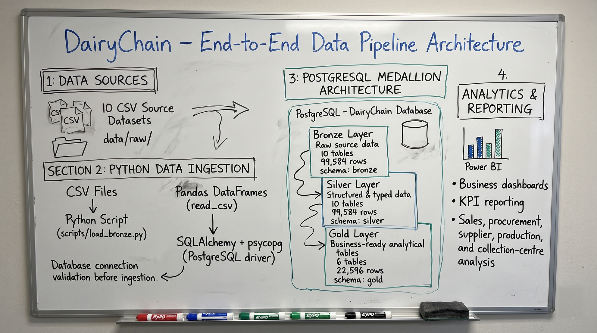

# Screenshots and Reports

> Status: PARTIALLY VERIFIED

## Purpose
This file answers which Power BI screenshots and reports exist for DairyChain, and which architecture diagrams exist as a visual reference. It is for a reader who needs to see the report and the system, not only read about it. Source: the user-supplied "DairyChain - Architecture Diagrams" document (Source 12, 2026-11-11, 11 sections).

## In this file
- The four Power BI pages
- What was supplied
- Power BI model - DAX, relationships, and model data - Source 23 (pbixray)
- Power BI dashboard screenshots - Source 24 (all 4 pages, rendered in Power BI Desktop)
- Power BI Model view - Source 24b (relationship lines, discrepancy with Source 23)
- How to add a screenshot
- Architecture diagrams - visual reference
- Diagram index
- Diagram design standards
- Diagram source and export requirements
- Accuracy and maintenance

## The four Power BI pages
The .pbix file was supplied (Source 22, 2026-11-11) and inspected from its Report definition JSONs. The file names its pages only "Page 1", "Page 2", "Page 3", "Page 4". The descriptive titles below are the on-page headings read from the textbox visuals in the file, not the file page names. The content mapping (which documented page each file page is) is inferred from the visuals on that page, and is labelled as inferred, not as a file name.

- Page 1 (file name "Page 1", 17 visuals), on-page heading "DairyChain | Business Performance & Analytics", subtitle "An Integrated View of Procurement, Production, Quality & Sales Performance". Content: sales KPI cards (Total Revenue, Total Orders, Delivered Orders, Total Products, Total Suppliers), order-status donut, revenue by category, revenue by product, daily revenue line. Inferred to be the documented Executive Overview page.
- Page 2 (file name "Page 2", 14 visuals), on-page heading "Procurement & Quality Analysis", subtitle "Monitoring milk procurement, supplier quality and collection centre performance." This matches the documented page name exactly.
- Page 3 (file name "Page 3", 14 visuals), on-page heading "Performance Analysis", subtitle "Monitoring production volume, output, efficiency and batch performance." Content is production (batches, raw milk, finished output, duration, shift, unit). Inferred to be the documented Production Performance Analysis page. Note: the on-page heading says "Performance Analysis" only, not "Production Performance Analysis".
- Page 4 (file name "Page 4", 18 visuals), on-page heading "Sales Analysis", subtitle "Tracking revenue, product performance, order fulfilment and sales trends." This matches the documented page name exactly.

Total: 63 visuals across the 4 pages. Dashboard screenshots for all 4 pages were supplied (Source 24, 2026-11-11, see the Source 24 section below), so the pages are now verified as rendered, with the KPI card values and visuals as shown recorded page by page. KPI values are also VERIFIED from the model data read with pbixray get_table (Source 23) - see the Source 23 section below - and the rendered card values match the model totals, except on Page 4, where a date filter is active in the screenshot (see the Page 4 finding in the Source 24 section).

## What was supplied
The .pbix file WAS supplied (Source 22, 2026-11-11, `dairy_chain_project.pbix`, 1.5 MB) and is stored in this folder. See "Power BI report file - Source 22" below. Power BI dashboard screenshots for all 4 pages WERE supplied (Source 24, 2026-11-11, taken in Power BI Desktop on the user's own Windows PC) and are stored in this folder as `powerbi-page-1-executive-overview.png`, `powerbi-page-2-procurement-quality.png`, `powerbi-page-3-production-performance.png`, and `powerbi-page-4-sales-analysis.png`. A Model view screenshot was also supplied (Source 24b). Status: VERIFIED for the file structure, measure names, visual inventory, DAX formulas, relationships in the uploaded file, KPI values, and rendered dashboard pages; the Model view screenshot disagrees with the uploaded file on relationships - see the Source 24b section below.

Two PostgreSQL terminal screenshots WERE supplied (Source 17, 2026-11-11) and are stored in this folder. They are evidence for the database connection and table inventory, not for Power BI. See "PostgreSQL screenshots - Source 17" below.

## PostgreSQL Gold row counts - Source 19

Screenshot: [postgresql-gold-row-counts.png](postgresql-gold-row-counts.png) (copied from the user-supplied image-7.png, 2026-11-11; original not deleted).

What it shows: the tail of the Source 18 column output ((238 rows)), then `\pset pager off`, then a UNION ALL COUNT(*) query over the 6 Gold tables, returning 6 rows: procurement_quality_summary 18000, collection_centre_performance 20, supplier_performance 200, production_performance 4000, sales_product_performance 12, sales_daily_summary 364. Total 22596.

Status: VERIFIED (Verified execution results). All 6 Gold row counts match the documented reference values exactly, in the live database. No run date is visible in the screenshot, so no run date is claimed. Bronze and Silver row counts in the database were not counted in this query and are still PENDING EVIDENCE.

## PostgreSQL constraints - Source 20

Screenshot: [postgresql-constraints-zero-rows.png](postgresql-constraints-zero-rows.png) (copied from the user-supplied image-8.png, 2026-11-11; original not deleted).

What it shows: a `pg_constraint` query joining `pg_constraint` to `pg_class` and `pg_namespace`, selecting schema, table, constraint name, constraint type (PRIMARY KEY, FOREIGN KEY, UNIQUE, CHECK, or the raw type), and the constraint definition, for schemas bronze, silver, and gold, ordered by schema, table, and constraint type. Result: `(0 rows)`.

Status: VERIFIED (Verified execution results). Zero constraints of any kind exist on any table in bronze, silver, or gold. This is consistent with Source 18, where all 238 columns are nullable YES with no column default. What it does NOT prove: indexes. `pg_constraint` does not cover indexes, so indexes are checked separately in Source 21 below (0 rows, VERIFIED ABSENT). No run date is visible in the screenshot, so no run date is claimed.

## PostgreSQL indexes - Source 21

Screenshot: [postgresql-indexes-zero-rows.png](postgresql-indexes-zero-rows.png) (copied from the user-supplied image-9.png, 2026-11-11; original not deleted).

What it shows: a `pg_index` query joining `pg_index` to `pg_class` (table and index) and `pg_namespace`, selecting schema, table, index name, is_primary, is_unique, is_valid, and the index definition, for schemas bronze, silver, and gold, ordered by schema, table, and index name. Result: `(0 rows)`.

Status: VERIFIED (Verified execution results). Zero indexes of any kind exist on any table in bronze, silver, or gold: no primary-key index, no unique index, and no other index. Together with Source 20 (0 constraints), this closes the keys and indexes question completely. This is consistent with Source 18, where all 238 columns are nullable YES with no column default. No run date is visible in the screenshot, so no run date is claimed.

## Power BI report file - Source 22

File: [dairy_chain_project.pbix](dairy_chain_project.pbix) (copied from the user-supplied `dairy_chain_project.pbix`, 1.5 MB, 1,564,682 bytes, md5 6ebef7a0e14f9beefa2207da39bd66ce, 2026-11-11; original not deleted).

What the file is: a modern Fabric/TMDL-format PBIX, Version 4, CreatedFrom Cloud, CreatedFromRelease 2026.10, report visual 2.14.0 / report 3.4.0 / page 2.3.1, theme Fluent2-CY26SU10, pages 1920x1080, FitToPage. Inspected by unzipping the file and reading its Report definition JSONs and DiagramLayout.

Model tables, VERIFIED from DiagramLayout (11 tables, matching the documented model exactly): 6 Gold tables (`gold collection_centre_performance`, `gold procurement_quality_summary`, `gold production_performance`, `gold sales_daily_summary`, `gold sales_product_performance`, `gold supplier_performance`) and 5 dimensions (`dim_date`, `dim_product`, `dim_supplier`, `dim_collection_centre`, `dim_unit`).

Visual inventory (counted from the Report definition JSONs): Page 1, 17 visuals (textbox 3, listSlicer 3, card 5, shape 1, actionButton 1, barChart 1, clusteredColumnChart 1, donutChart 1, lineChart 1); Page 2, 14 visuals (shape 1, textbox 3, listSlicer 1, clusteredBarChart 2, clusteredColumnChart 2, cardVisual 4, donutChart 1); Page 3, 14 visuals (shape 2, textbox 2, listSlicer 1, columnChart 1, lineChart 1, pivotTable 1, clusteredColumnChart 2, donutChart 1, cardVisual 3); Page 4, 18 visuals (textbox 3, listSlicer 2, slicer 1, shape 2, clusteredColumnChart 1, columnChart 1, barChart 1, tableEx 1, lineChart 1, donutChart 1, cardVisual 4). Total 63 visuals.

Measure names referenced by visuals (13, names only, no formula claimed): Total Revenue, Total Orders, Delivered Orders, Total Products, Total Suppliers, Total Milk Procured, Total Accepted Milk, Total Rejected Milk, Overall Rejection Rate, Total Production Batches, Total Raw Milk Processed (L), Average Production Duration, Daily Revenue. Their table bindings, as referenced in the visuals: Total Revenue, Total Orders, Delivered Orders, Total Products, Total Suppliers on `gold collection_centre_performance` (Page 1 cards); Total Milk Procured on `gold procurement_quality_summary` (Page 2); Total Accepted Milk on `dim_collection_centre` (Page 2); Total Rejected Milk and Overall Rejection Rate on `gold collection_centre_performance` (Page 2); Total Production Batches, Total Raw Milk Processed (L), Average Production Duration on `dim_collection_centre` (Page 3); Daily Revenue on `dim_date` (Page 1 line chart). Page 4 cards use plain columns, not measures: `total_revenue`, `total_orders`, `quantity_fulfilled` on `gold sales_daily_summary`, and `average_selling_price` on `gold sales_product_performance`.

Anomaly to check, not an error: several card visuals reference measures on tables that do not hold that subject's data - the 5 Page 1 sales KPI cards, the Page 2 Total Rejected Milk and Overall Rejection Rate cards, and the 3 Page 3 production cards. A measure in Power BI can be defined on any table and referenced anywhere, so the binding alone does not prove a wrong value. The definition (the DAX formula) is what matters. Source 23 extracted the formulas with pbixray: the measures ARE defined on those tables, and the formulas reference other tables directly - see the Source 23 section below. `gold supplier_performance` and `dim_supplier` have no visual reference at all in the report JSONs.

Slicers verified as present in the file: Page 1, `dim_product[product_name]`, `dim_product[category]`, `dim_date[Date]` plus an auto date table (`LocalDateTable_35cdc80e-794c-497b-b88a-72fa9e52813f`, Year and Quarter); Page 2, `gold procurement_quality_summary[shift]`; Page 3, `dim_unit[Unit]` and `gold production_performance[unit_of_measure]`; Page 4, `gold sales_daily_summary[order_date]`, `gold sales_product_performance[Short Product Name]`, `gold sales_product_performance[category]`. Slicer filter behaviour is still not verified as rendered, and Source 23 found only one relationship in the model, so most slicers have no relationship path to follow - see the Source 23 section below.

What this file does NOT prove: no KPI value shown on a rendered page was verified from the file alone - but that gap is now CLOSED by Source 24, which supplied rendered screenshots of all 4 pages from Power BI Desktop (see the Source 24 section below). UPDATED by Source 23: the DataModel file inside the .pbix is an XPress9-compressed Analysis Services backup (1,501,438 bytes, md5 103248d4e6dbc86f47c12889aba59f38), which could not be parsed by unzipping alone, but pbixray read it: DAX formulas for 21 measures, the single relationship, Power Query, and the model data are now VERIFIED - see the Source 23 section below. The only DAX text found in the Report definition JSONs is in one Page 4 table visual, where the totals use visual calculations `EXPANDALL(SUM([Total Orders_Base]), ROWS COLUMNS)` and `EXPANDALL(SUM([Total Revenue_Base]), ROWS COLUMNS)` over the Total Orders and Total Revenue measures. Those are table totals, not the measure definitions.

Status: PARTIALLY VERIFIED (Verified implementation for the file structure, model tables, visual inventory, measure names, and slicer fields; DAX formulas, relationship properties, and KPI values now VERIFIED by Source 23; Items still requiring evidence for rendered screenshots only).

## Power BI model - DAX, relationships, and model data - Source 23
Source: `dairy_chain_project.pbix`, read with the open-source pbixray Python library (Source 23, 2026-11-11). pbixray reads the model without Power BI Desktop. Evidence files: [pbixray_dax_measures.txt](pbixray_dax_measures.txt) (full DAX dump, 291 lines) and [pbixray_model_data_totals.txt](pbixray_model_data_totals.txt) (computed totals from the model data). Model metadata: Culture en-US, ModifiedTime 2026-11-09 21:23:18, StructureModifiedTime 2026-11-10 19:52:10.

### DAX - VERIFIED
23 rows in `dax_measures`, 21 with formulas, 2 empty (`Measure` on `gold sales_product_performance` and `Measure 2` on `dim_collection_centre`, unused placeholders, no formulas invented). Full formulas are in [../04_Business_Analytics/kpi_definitions.md](../04_Business_Analytics/kpi_definitions.md). Key corrections against the representative DAX: Total Rejected Milk is a plain SUM of `gold collection_centre_performance[rejected_milk_litres]`, not the representative CALCULATE on procurement quantity. `Short Product Name` on `gold sales_product_performance` is a calculated column, not a measure, and the `Short Product Name` measure on `dim_collection_centre` references `[product_name]`, which is not a column of that table, so it is flagged as broken or unused, not verified working. `procurement_date` and `production_date` are DAX calculated columns derived from the timestamps - this RESOLVES the Source 11 dim_date mismatch definitively. The five dimensions are DAX calculated tables derived from the Gold tables, not tables loaded from PostgreSQL. Power Query loads only the 6 Gold tables from `PostgreSQL.Database("localhost:5432", "dairychain")`, Schema gold.

### Relationships - VERIFIED, only 1 exists
Only one relationship exists in the model: `gold procurement_quality_summary[supplier_id]` to `gold supplier_performance[supplier_id]`, IsActive 1, Cardinality M:1, CrossFilteringBehavior Single, FromKeyCount 203, RelyOnReferentialIntegrity 0. None of the 10 intended dimension relationships exists. Consequence: most slicers do not propagate through the model as documented. The Source 22 anomaly is now EXPLAINED: measures are defined on `gold collection_centre_performance` and `dim_collection_centre` because those tables were used as the measure-host tables, and the formulas reference other tables directly - for example Total Revenue on `gold collection_centre_performance` is a plain SUM of `gold sales_product_performance[total_revenue]`, which works without a relationship because it is a plain SUM. Without relationships, those measures do not filter by the slicers on other tables.

### Model-data totals - VERIFIED from the model data
Totals were computed from the model tables with pbixray get_table (Source 23) and match the README exactly: procurement 18,000 batches, 15,689 accepted, 2,311 rejected, 12.84 percent batch rejection, total milk 8,758,507.64 L, rejected 1,117,247.35 L, 12.76 percent volume rejection; sales revenue Rs 26,734,294.03, 14,000 orders, delivered 11,166, partial 2,227, cancelled 607, quantity ordered 181,804, fulfilled 161,036.41, 88.58 percent; production 4,000 batches (3,001 litre, 999 kg), raw milk 2,600,000.0 L, finished 1,484,135.25 L and 266,416.65 kg, byproduct 466,514.75 L and 402,413.85 kg; collection-centre and supplier totals reconcile to the same milk and batch totals. Product revenue sums to Rs 26,734,294.03, matching daily, but product `total_orders` sums to 28,000, not 14,000 - this PROVES the docs warning: do not sum product-level `total_orders`, an order appears once per product. Full totals are in [pbixray_model_data_totals.txt](pbixray_model_data_totals.txt). FLAG: the model data holds unit values "Litre" and "Kilogram" (full words), while the DAX Finished Output (L) and Finished Output (kg) measures filter `unit_of_measure` = "L" and "kg", so those two measures would return blank unless the filter matches - flagged to check in Power BI, not called wrong.

### What Source 23 does NOT prove
UPDATED by Source 24: dashboard screenshots for all 4 pages were supplied and the visual values as shown are now recorded in the Source 24 section below. No Gold SQL, no DDL, no Bronze or Silver row counts. The missing relationships are not claimed to exist. UPDATED by Source 24b: a Model view screenshot shows relationship lines that do not exist in the uploaded file - see the Source 24b section below.

## Power BI dashboard screenshots - Source 24

Source: 4 screenshots taken by the user in Power BI Desktop on his own Windows PC, supplied 2026-11-11, copied into this folder with md5 verified, originals not deleted. No run date is visible in the screenshots, so no run date is claimed; they are recorded as user-supplied 2026-11-11.

- Page 1: [powerbi-page-1-executive-overview.png](powerbi-page-1-executive-overview.png) (copied from the user-supplied image-10.png, 1270x717, md5 db6d5c8942fc49bdf57af567c2f38ff8)
- Page 2: [powerbi-page-2-procurement-quality.png](powerbi-page-2-procurement-quality.png) (copied from the user-supplied image-11.png, 1269x719, md5 379c88be1ac2e80bef0d79e7d1d3206d)
- Page 3: [powerbi-page-3-production-performance.png](powerbi-page-3-production-performance.png) (copied from the user-supplied image-12.png, 1268x722, md5 a2a4410b3a381c514636766ca4d7916f)
- Page 4: [powerbi-page-4-sales-analysis.png](powerbi-page-4-sales-analysis.png) (copied from the user-supplied image-13.png, 1270x723, md5 836ce8fe069f2e58063aa3f1e3525b3f)

Status: VERIFIED (Verified execution results - rendered pages). The screenshot gap is now CLOSED: all 4 pages have screenshots. Values shown in the screenshots are recorded below exactly as shown. Where a card shows a rounded value (for example 1.12M), the exact verified value from the model data (Source 23) is given alongside it. No value was read that cannot be read clearly; approximate chart readings are labelled approximate.

### Page 1 - Executive Overview

Heading: "DairyChain | Business Performance & Analytics". Subtitle: "An Integrated View of Procurement, Production, Quality & Sales Performance". This is the documented Executive Overview page.

KPI cards, exactly as shown (no date filter active, full period):
- Total Revenue: 2,67,34,294.03 (card header reads "Total Revenue", subtitle "Total Revenue") - matches the model total Rs 26,734,294.03 exactly (Source 23).
- Total Orders: 14000.00 (card header reads "Total order", subtitle "Total Orders") - matches the model total 14,000 exactly.
- Delivered Orders: 11166.00 (subtitle "Delivered Orders") - matches the model total 11,166 exactly.
- Total Suppliers: 200.00 (subtitle "Total Suppliers") - matches the model total 200 exactly.
- Total Products: 12.00 (subtitle "Total Products") - matches the model total 12 exactly.

Visuals present:
- Total Revenue by product_name (horizontal bar chart): Pure Cow & Buffalo Ghee longest at about 6M, then Fresh Malai Paneer, Pasteurised Table Butter, Fresh Dairy Cream, Elaichi Flavoured Milk, Probiotic Lassi, Classic Set Curd, Full Cream Milk. Only 8 products are visible; a scrollbar shows the other 4 are scrolled out of view.
- Total Revenue by category (column chart): Fat Rich 13498K, Coagulated 5531K, Liquid Milk 3259K, Beverage 2232K, Fermented 2214K. These match the Source 23 category revenues exactly (Fat Rich Rs 13,497,989.08, Coagulated Rs 5,531,071.00, Liquid Milk Rs 3,258,914.70, Beverage Rs 2,231,962.50, Fermented Rs 2,214,356.75) at the rounded precision shown.
- Monthly Revenue (line chart, titled "Mnthly Revenue" as shown, subtitle "Daily Revenue by Year and Month"): daily revenue by year and month, about 2.1M to 2.4M per month, Nov 2025 to Sep 2026, with peaks around Mar 2026 and Aug 2026 and a low around Feb 2026.
- Order status breakdown (donut, "Sum of delivered_orders, Sum of partially_delivered_orders and Sum of cancelled_orders"): centre 11K, delivered 11K (79.76 percent), partially delivered 2K (15.91 percent), cancelled 1K (4.34 percent) - matches the model counts 11,166 / 2,227 / 607 exactly.
- Filters: Year, Quarter and Month; product_name; category. No filter is set in the screenshot.

### Page 2 - Procurement & Quality Analysis

Heading: "Procurement & Quality Analysis". Subtitle: "Monitoring milk procurement, supplier quality and collection centre performance." This matches the documented page name exactly.

KPI cards, exactly as shown (rounded, no date filter active):
- Total Rejected Milk: 1.12M - exact model value 1,117,247.35 L (Source 23).
- Total Milk Procured: 8.76M - exact model value 8,758,507.64 L.
- Overall Rejection Rate: 12.76 percent - this is the VOLUME rejection rate (rejected litres divided by total litres). Do not confuse it with the batch rate on the same page.
- Total Accepted Milk: 7.64M - exact model value 7,641,260.29 L.

Visuals present:
- Procurement Quality Distribution (donut, "Count of procurement_id by quality_status"): centre 18K, rejected 2.31K (12.84 percent), accepted 15.69K (87.16 percent) - the BATCH counts and batch rejection rate, 2,311 of 18,000. Both rates are visible on this page: 12.84 percent is the batch rate, 12.76 percent is the volume rate.
- Milk Procurement by Supplier District (horizontal bar chart, "Sum of quantity_litres by supplier_district"): ranking, highest to lowest: Sabarkantha, Banaskantha, Kheda, Mehsana, Anand, Satara, Kolhapur, Kolar, Pune, Hisar, Karnal, Mysuru, Rajkot, Mandya, Ludhiana. All 15 district bars fall between about 0.52M and 0.64M litres, read approximately from the axis, so the ranking is verified but the exact per-district litres are NOT readable from the chart and are not claimed here. This ranking answers PR-03 in part - see the PR-03 note in [05_procurement_and_supplier_analysis.md](../05_Business_Questions_and_Answers/05_procurement_and_supplier_analysis.md).
- Sum of quantity_litres by shift (column chart): Morning about 4.6M litres, Evening about 3.9M litres, read approximately from the axis. The exact shift totals from the model data are Morning 4,801,175.33 L and Evening 3,957,332.31 L (Source 23), which agree with the chart at the precision shown.
- Average Fat & SNF by Quality Status (clustered column chart, subtitle "Sum of snf_percentage and Sum of fat_percentage b..."): Accepted SNF about 138K and fat about 77K; Rejected SNF about 20K and fat about 11K. FLAG, not an error in the data: the chart plots SUMS of percentages across batches, not averages, even though the title says "Average". Summing a percentage across batches has no business meaning, and the accepted sums are larger mainly because there are 15,689 accepted batches against 2,311 rejected ones. Do not use these numbers as average fat or SNF. QL-05 (average fat and SNF by quality status) is therefore NOT answered by this chart and stays PENDING EVIDENCE.
- Procurement Rejection Reasons (horizontal bar chart, "Count of procurement_id by rejection_reason"): (Blank) 15.7K, Low SNF (<8.2 percent) 1.3K, Low Fat (<3.2 percent) 0.5K, High Acidity (>0.17 percent) 0.5K, High Temperature (>8.5C) 0.0K. The (Blank) bar is 15.7K, which matches the 15,689 accepted batches that have no rejection reason - recorded as an inferred interpretation, not a label on the chart. The reason counts match the model data exactly (Low SNF 1,303, Low Fat 513, High Acidity 491, High Temperature 4).
- Filter: shift (Filter the analysis by shift). No filter is set in the screenshot.

### Page 3 - Performance Analysis

Heading: "Performance Analysis". Subtitle: "Monitoring production volume, output, efficiency and batch performance." Content is production, so this is the documented Production Performance Analysis page; the on-page heading says "Performance Analysis" only, not "Production Performance Analysis".

KPI cards, exactly as shown (rounded, no date filter active):
- Average Production Duration: 135.03 - matches the model average 135.03 minutes exactly (Source 23).
- Total Raw Milk Processed (L): 2.60M - exact model value 2,600,000.0 L.
- Total Production Batches: 4K - exact model value 4,000.

Visuals present:
- Raw Milk Input vs Finished Output (clustered column chart, "Sum of total_raw_milk_litres and Sum of finished_product_quantity by product_name"): for the litre products the finished bar is close to the raw milk bar (about 0.2M each); for the kg products (Fresh Dairy Cream, Fresh Malai Paneer, Pasteurised Table Butter, Probiotic Lassi, Pure Cow & Buffalo Ghee) the finished bar is tiny, because the finished quantity is in kilograms while the raw milk input is in litres - the chart mixes units on one axis, so read the kg bars only as "much smaller in the chart", not as a yield.
- Raw Milk Processed Over Time (line chart, "Sum of total_raw_milk_litres by Year, Quarter and Month"): about 200K to 220K litres per month, Nov 2025 to Sep 2026, with a dip to about 200K around Feb 2026.
- Finished Product Output by Unit of Measure (column chart, "Sum of finished_product_quantity..."): Litre about 1.48M, Kilogram about 0.27M - matches the model values 1,484,135.25 L and 266,416.65 kg.
- Finished Product Output by Product (donut, "Sum of finished_product_quantity by product_name"): centre total 1.75M. FLAG: 1.75M is the sum of 1,484,135.25 L and 266,416.65 kg, which adds litres and kilograms together. Litres and kilograms must never be added. The donut total is recorded as shown, but it is not a valid total output figure.
- Production Batches by Shift (column chart, "Count of production_id by shift"): Shift-B (14:00-22:00) about 2.2K, Shift-A (06:00-14:00) about 1.1K, Shift-C (22:00-06:00) about 0.7K, read approximately from the axis.
- Production Performance by Product (table, "Sum of production_duration_minutes" and "Sum of byproduct_quantity" by product_name): 12 product rows. Table total row: Sum of production_duration_minutes 5,40,105.96, Sum of byproduct_quantity 8,68,928.60. The duration total divided by 4,000 batches is 135.03 minutes, which matches the Average Production Duration card. FLAG: the byproduct total 8,68,928.60 is exactly 466,514.75 L plus 402,413.85 kg, so it also adds litres and kilograms together - recorded as shown, not as a valid total.
- Filter: Unit (Filter by kg/L). No filter is set in the screenshot.

### Page 4 - Sales Analysis

Heading: "Sales Analysis". Subtitle: "Tracking revenue, product performance, order fulfilment and sales trends." This matches the documented page name exactly.

IMPORTANT FINDING - a date filter is ACTIVE in this screenshot: "Filter by date 01-04-2026 to 06-10-2026" (dates in DD-MM-YYYY format as shown). The cards below show FILTERED values for about 1 Apr 2026 to 6 Oct 2026, not the full period. Do NOT present them as the full-period totals. The full-period totals, verified from the model data (Source 23), are revenue Rs 26,734,294.03 and 14,000 orders.

KPI cards, exactly as shown (FILTERED, Apr to Oct 2026):
- Total Sales Revenue: 13.80M - filtered value only, not the full-period Rs 26,734,294.03.
- Total Orders: 7K - filtered value only, not the full-period 14,000.
- Quantity Fulfilled: 83.90K - filtered value only, not the full-period 161,036.41.
- Average Selling Price: 2.28K - as shown on the card. This card uses the plain `average_selling_price` column, not a weighted average, so do not read it as the average price per unit sold.

Visuals present:
- Daily Sales Revenue Trend (line chart, "Sum of total_revenue by Date"): daily revenue, about 40K to 110K per day, Apr 2026 to Oct 2026, highly variable day to day with no smooth trend visible. This is the filtered range only, not the full Nov 2025 to Oct 2026 range.
- Order Distribution by Product Category (donut, "Total Orders by category"): centre 7K, and each of the 6 slices is labelled 7K (16.67 percent): (Blank), Beverage, Coagulated, Fat Rich, Fermented, Liquid Milk. FLAG: the slices add to about 42K, not the 7K centre total - this is the same double-counting proved in Source 23, where each order is counted once per product or category. The (Blank) category also appears here, with no label explaining it.
- Top 4 Products by Average Selling Price (bar chart, "Sum of average_selling_price by Short..."): Pure Cow & Buffalo Ghee about 620, Pasteurised Table Butter about 520, Fresh Malai Paneer 380.00 (confirmed by the visible tooltip: "Short Product Name Fresh Malai Pan... / Sum of average_selling_price 380.00"), Fresh Dairy Cream partly visible. Note: these are sums of per-product average prices, not average prices themselves.
- Top 6 Products by Revenue (bar chart, "Total Revenue by Short Product Name"): Pure Cow & Buffalo Ghee about 6M, Fresh Malai Paneer about 5.5M, Pasteurised Table Butter about 5.15M, Fresh Dairy Cream about 2.35M, Elaichi Flavoured Milk about 1.8M, Probiotic Lassi about 1.12M - matching the Source 23 product revenues.
- Product Performance (table, product_name, Total Orders, Total Revenue): 12 product rows, each showing Total Orders 7292, with Total Revenue per product as listed (Spiced Masala Buttermilk 4,32,450.00, Double Toned Milk 6,94,144.80, Toned Milk 7,96,826.70, Standardised Milk 8,51,256.00, Full Cream Milk 9,16,687.20, Classic Set Curd 10,91,328.75, Probiotic Lassi 11,23,028.00, Elaichi Flavoured Milk 17,99,512.50, Fresh Dairy Cream 23,54,907.50, Pasteurised Table Butter 51,56,439.08, Fresh Malai Paneer 55,31,071.00, Pure Cow & Buffalo Ghee 59,86,642.50). Table Total row: 94796 orders, 2,67,34,294.03 revenue. Two flags on this table. First, the total revenue 2,67,34,294.03 is the FULL-period revenue, while the cards above it are filtered to Apr-Oct 2026 - the table and the cards do not cover the same period, because the table does not follow the date filter in the same way. Second, the total orders 94,796 does not equal 12 rows of 7,292, which would be 87,504; the difference is exactly 7,292, one more row, so a 13th row is probably scrolled out of view. This is recorded as an observed inconsistency, not resolved.
- A stacked bar visual is partly visible behind the tooltip (category by product, values to about 60K), but it is obscured by the tooltip, so no values are claimed from it.
- Filters: date (01-04-2026 to 06-10-2026, ACTIVE), category, Short Product Name.

## Power BI Model view - Source 24b

Source: 1 screenshot of the Power BI Desktop Model view, supplied by the user 2026-11-11, copied into this folder as [powerbi-model-view-relationships.png](powerbi-model-view-relationships.png) (copied from the user-supplied image-14.png, 1210x772, md5 9f161d2a606eff294eaf704f3625ea20). No run date is visible in the screenshot, so no run date is claimed; it is recorded as user-supplied 2026-11-11.

What it shows: the 11 model tables (6 Gold tables and 5 dimensions) with relationship LINES between them, with 1 and * cardinality markers at the ends of the lines. Lines are visible between these table pairs: gold supplier_performance to gold procurement_quality_summary; gold procurement_quality_summary to dim_collection_centre; gold collection_centre_performance to dim_collection_centre; gold sales_daily_summary to dim_date; gold sales_product_performance to dim_product; dim_supplier, dim_product, and dim_unit each to gold production_performance; and gold procurement_quality_summary to gold production_performance. About ten lines are visible in total, but lines cross and overlap, so the exact count cannot be read with certainty from the image, and the exact join columns cannot be read either - the table cards are truncated (for example "gold suppli...", "gold procurement_q...") and the column lists are collapsed. No claim is made here about which column joins which.

DISCREPANCY - recorded exactly, not resolved by guessing: pbixray on the uploaded .pbix file (Source 23) found ONLY ONE relationship in the file, `gold procurement_quality_summary[supplier_id]` to `gold supplier_performance[supplier_id]`. The Model view screenshot shows many relationship lines. Both findings are kept as recorded. The most likely explanation is that the user added relationships in Power BI Desktop AFTER uploading the .pbix here, or that the screenshot is from a newer saved version of the file than the one uploaded - but neither is confirmed, so neither is claimed as fact. The Source 23 finding (1 relationship in the uploaded file) is NOT overwritten. The user is asked to re-upload the .pbix if he saved the model with those relationships, so the file and the screenshot match. Until then, any claim about relationships must say which source it comes from: the uploaded file (1 relationship) or the Model view screenshot (many lines, columns unreadable).

Status: VERIFIED as a screenshot of the Model view (visual evidence that lines exist between those tables); the join columns, cardinality direction, and active status of those lines are PENDING EVIDENCE.

## How to add a screenshot
For each page, add the screenshot, the date, the Gold table it reads, and the DAX measures it uses. Check that the numbers in the screenshot match the Gold totals in this set before the screenshot is kept as evidence.

## PostgreSQL screenshots - Source 17

> Status: VERIFIED EXECUTION RESULTS

Two user-supplied Windows PowerShell screenshots, 2026-11-11. No run date is visible in either image, so no run date is claimed; they are recorded as user-supplied 2026-11-11.

### Screenshot 1 - Connection, server version, schemas
File: [postgresql-connection-and-schemas.png](postgresql-connection-and-schemas.png) (original: image-5.png, 1915x1028)

Command: `& "C:\Program Files\PostgreSQL\18\bin\psql.exe" -h localhost -p 5432 -U postgres -d dairychain`. Password prompt answered, banner `psql (18.6)` shown, code-page warning recorded (console code page 437 differs from Windows code page 1252). Connection query returned 1 row: `dairychain | postgres | ::1 | 5432 | PostgreSQL 18.6 on x86_64-windows, compiled by msvc-19.44.35229, 64-bit`. Schema query returned 5 rows: `bronze, gold, pg_toast, public, silver`. The table inventory query is started at the bottom of this screenshot and its result is in screenshot 2.

### Screenshot 2 - Table inventory, 26 rows
File: [postgresql-table-inventory.png](postgresql-table-inventory.png) (original: image-6.png, 1919x929)

The same table inventory query result, 26 rows total: bronze 10 (`collection_centres, milk_procurement, production_batches, production_inputs, production_outputs, products, quality_tests, sales_order_lines, sales_orders, suppliers`), gold 6 (`collection_centre_performance, procurement_quality_summary, production_performance, sales_daily_summary, sales_product_performance, supplier_performance`), silver 10 (identical to the bronze list). The full transcribed inventory is in [data_dictionary.md](../02_System_Architecture/data_dictionary.md).

What these screenshots do NOT prove: Gold SQL or any business query result. Row counts are now VERIFIED by Source 19, column names and types by Source 18, constraints are VERIFIED ABSENT by Source 20 (0 rows), and indexes are VERIFIED ABSENT by Source 21 (0 rows). The next step is the Bronze/Silver row-count queries from Source 16.

## Architecture diagrams - visual reference

> Status: PARTIALLY VERIFIED - ONE IMAGE SUPPLIED (Source 27)

The diagrams explain how source data moves through Python ingestion, PostgreSQL processing layers, and Power BI reporting. They are designed to communicate the system at four levels: overall system architecture, database layer architecture, end-to-end data pipeline, and Power BI reporting architecture.

**IMAGE FILES, UPDATED BY SOURCE 27:** The architecture whiteboard image `docs/assets/architecture-whiteboard.png` was supplied by the user 2026-11-11 (Source 27) and is the first of the diagram images to exist. The four PNGs listed in the diagram index below are still intended exports under `docs/assets/` and are still NOT SUPPLIED. The Mermaid source in the architecture docs remains the current visual reference for those four. The Mermaid source is maintained in the corresponding architecture documents, and the diagram images are for easier viewing in GitHub and project presentations.

## Diagram index

| Diagram | Intended image file | Main purpose | Status |
|---|---|---|---|
| Architecture whiteboard (Medallion) | `architecture-whiteboard.png` | Show the end-to-end pipeline with Bronze, Silver, and Gold inside one PostgreSQL database | SUPPLIED by Source 27 |
| System Architecture | `system-architecture.png` | Explain the complete system | NOT SUPPLIED |
| Database Layer Architecture | `database-layer-architecture.png` | Explain Bronze, Silver, and Gold | NOT SUPPLIED |
| ETL/ELT Data Flow | `data-flow-architecture.png` | Explain how data moves through the pipeline | NOT SUPPLIED |
| Power BI Reporting Architecture | `powerbi-reporting-architecture.png` | Explain how Gold tables support reporting | NOT SUPPLIED |

The whiteboard image is a user-supplied illustration of the intended pipeline (Source 27, 2026-11-11). Accuracy flag: the whiteboard itself shows four implementation details that are NOT verified and must not be read as verified implementation: "Python Script (scripts/load_bronze.py)", "SQLAlchemy + psycopg (Postgres driver)", "Pandas DataFrames (read_csv)", and "Database connection validation before ingestion". The verified evidence (Source 15 notebook) shows pandas `read_csv` in Google Colab only, with NO SQLAlchemy, NO psycopg, NO `load_bronze.py`, and NO local scripts folder. Those four details are unconfirmed and still need evidence.

All exported images should be saved under `docs/assets/`.

### Diagram 1 - System Architecture
Intended file: `system-architecture.png`

Objective: Show the complete DairyChain architecture from source files to the final Power BI dashboard.

Main components: source CSV files, Python ingestion, PostgreSQL database, Bronze schema, Silver schema, Gold schema, Power BI data model, business intelligence dashboard.

Data flow: CSV Files to Python to PostgreSQL Bronze to Silver to Gold to Power BI.

What it communicates: the separation of responsibilities between ingestion, database transformation, and reporting. Python handles data ingestion, PostgreSQL stores and processes data, SQL supports transformations, and Power BI presents the analytical results.

Where to use it: README project overview, technical report introduction, project demonstration, portfolio presentation.

Mermaid source: [docs/02_System_Architecture/system_architecture.md](../02_System_Architecture/system_architecture.md).

### Diagram 2 - Database Layer Architecture
Intended file: `database-layer-architecture.png`

Objective: Explain how the PostgreSQL database is organised into three schemas.

Main components: database `dairychain`.

| Schema | Responsibility | Recorded tables |
|---|---|---:|
| `bronze` | Ingested source data | 10 |
| `silver` | Cleaned and transformed data | 10 |
| `gold` | Analytical reporting data | 6 |

What it communicates: each schema represents a different stage of data processing. The Bronze layer contains the ingested records, the Silver layer contains cleaned tables, and the Gold layer contains analytical tables used by Power BI.

Where to use it: database architecture documentation, README technical overview, technical report database section, project demonstration.

Mermaid source: [docs/02_System_Architecture/database_design.md](../02_System_Architecture/database_design.md).

### Diagram 3 - ETL/ELT Data Flow
Intended file: `data-flow-architecture.png`

Objective: Explain the movement and transformation of data across the pipeline.

Main stages:

1. Read the source CSV files.
2. Use Python for ingestion.
3. Load data into PostgreSQL Bronze.
4. Transform data into Silver using SQL.
5. Prepare analytical data in Gold using SQL.
6. Use Gold tables in Power BI.

What it communicates: the pipeline follows an ELT-style transformation pattern. Data is loaded into PostgreSQL before the downstream SQL transformations are performed. The diagram should make the difference between ingestion and transformation stages clear.

Where to use it: ETL/ELT pipeline documentation, README technical overview, data engineering portfolio section, project demonstration.

Mermaid source: [docs/02_System_Architecture/data_flow.md](../02_System_Architecture/data_flow.md) and [docs/03_Data_Engineering/data_ingestion.md](../03_Data_Engineering/data_ingestion.md).

### Diagram 4 - Power BI Reporting Architecture
Intended file: `powerbi-reporting-architecture.png`

Objective: Explain how the PostgreSQL Gold tables are connected to the Power BI reporting model.

Main components:

Gold reporting tables: procurement quality summary, collection centre performance, supplier performance, production performance, sales product performance, sales daily summary.

Power BI dimensions: `dim_date`, `dim_product`, `dim_supplier`, `dim_collection_centre`, `dim_unit`.

Dashboard pages:

1. Executive Overview.
2. Procurement and Quality Analysis.
3. Production Performance Analysis.
4. Sales Analysis.

What it communicates: Gold tables supply the reporting data, dimensions support filtering, and DAX measures provide the calculations used in the four dashboard pages. The diagram should show the logical reporting architecture without suggesting that unrelated tables are directly connected.

Where to use it: Power BI documentation, README dashboard overview, technical report, project demonstration.

Mermaid source: [docs/04_Business_Analytics/analytics_methodology.md](../04_Business_Analytics/analytics_methodology.md).

## Diagram design standards
All four diagrams should follow a consistent visual design.

Layout: use a clear top-to-bottom or left-to-right flow, keep the number of crossing connector lines to a minimum, group related components, maintain consistent spacing, use readable labels, and avoid unnecessary decorative elements.

Visual hierarchy: use consistent visual categories for each component type.

| Component | Suggested visual category |
|---|---|
| Source data | Blue |
| Processing stages | Amber |
| Database layers | Green |
| Reporting components | Purple |

Use these categories consistently across the architecture diagrams.

Technical accuracy: every diagram must reflect the documented implementation. Do not add Apache Airflow, cloud services, real-time ingestion, scheduled orchestration, external APIs, or automated monitoring systems. These are not established components of the documented current architecture.

## Diagram source and export requirements
The diagrams should remain editable. Use Mermaid source code in Markdown rather than maintaining only flattened images.

Recommended approach:

1. Keep the Mermaid source in the architecture Markdown documents.
2. Export each diagram as SVG or PNG.
3. Save the exported image in `docs/assets/`.
4. Reference the image from the relevant Markdown document.
5. Update the README with the same image where appropriate.

Recommended image specifications:

| Property | Recommendation |
|---|---|
| Format | SVG preferred; PNG as fallback |
| Background | White or transparent |
| Orientation | Landscape where practical |
| Readability | Text readable at normal GitHub viewing size |
| Resolution | High enough for presentations |
| Naming | Lowercase, hyphen-separated names |

## Accuracy and maintenance
Whenever the project architecture changes, update the relevant Mermaid source, the exported image, the architecture documentation, and the README image or reference, where affected. Do not allow the diagrams and implementation to describe different systems. The diagrams should be treated as technical documentation, not merely portfolio decoration.

Conclusion from Source 12: the four architecture diagrams provide complementary views of DairyChain. Together, they explain the overall application, database organisation, data-processing workflow, and Power BI reporting structure. They make the project easier to understand for reviewers, interviewers, and other developers without requiring them to inspect every source file.

## Next step / Related files
- [Implementation status](implementation_status.md)
- [Verification record](verification_record.md)
- [Data dictionary](../02_System_Architecture/data_dictionary.md)
- [System architecture](../02_System_Architecture/system_architecture.md)
- [Analytics methodology](../04_Business_Analytics/analytics_methodology.md)
